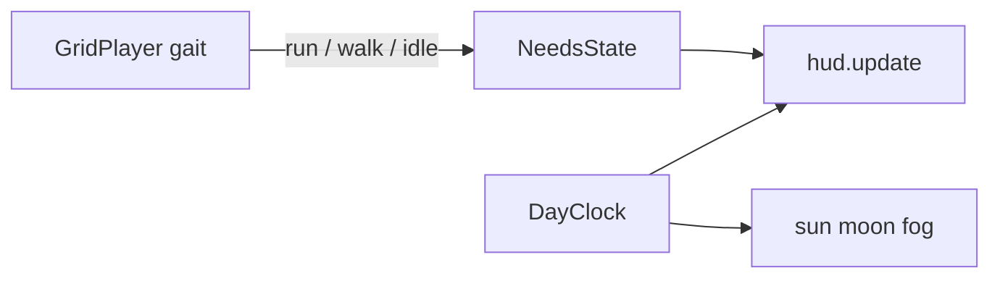

# HUD, stamina, and day/night

Yes. This pass: **HUD for everything**, **stamina actually works**, **day/night lighting**, weather icons exist but stay on **sun** (or night sky — no rain yet).

Thirst / hunger / temperature / health sit at **0.5** and do not drain.

## HUD (HTML overlay, not Three.js)

Add markup in [`web/index.html`](web/index.html) and styles in [`web/src/style.css`](web/src/style.css). Keep [`#hint`](web/index.html) bottom-left.

**Top-right (`#hud-world`)**
- Weather glyph (inline SVG): `sun` | `sunCloud` | `cloud` | `rain` | `storm`. Current weather is always `sun` while raining is unimplemented; at night we still show **sun weather** (clear) — time of day is the clock, not a moon-as-weather swap.
- Clock: game time as `HH:MM` (24h island clock).

**Bottom-right (`#hud-needs`)** — five DayZ-style meters in a column:
- Bordered rounded square, glyph in the middle
- Fill from the **bottom** (`overflow: hidden` inner fill, height = 0–100%)
- Colors: energy yellow, thirst blue, hunger orange, temp red/white, health red
- Glyphs: bolt, droplet, apple, thermometer, heart (inline SVG, no extra vendor pack)

New [`web/src/hud.ts`](web/src/hud.ts): `createHud()` returns `update(state)` that sets fill heights, weather icon, and clock text.



## Needs + stamina

New [`web/src/needs.ts`](web/src/needs.ts):

```ts
energy, thirst, hunger, temperature, health  // 0..1
```

Defaults: energy `1`, others `0.5`.

Tick in the frame loop:
- **Run:** drain energy (can’t sprint forever — ~6–8s of sprint to empty)
- **Idle:** recover fast (~3s empty→full)
- **Walk:** recover slowly (~12s empty→full)

[`web/src/player.ts`](web/src/player.ts): expose `gait` / `wantsSprint`. If Shift is held but `energy <= 0`, treat as **walk**. Allow run again after a small refill (e.g. `> 0.08`) so it doesn’t flicker.

Constants in [`web/src/constants.ts`](web/src/constants.ts): drain/recover rates.

## Day / night lighting

New [`web/src/dayNight.ts`](web/src/dayNight.ts):
- `DAY_SECONDS` ≈ **8 minutes** real time for a full 24h (tweakable)
- `t = 0` midnight, `0.25` dawn, `0.5` noon, `0.75` dusk
- Sun `DirectionalLight` orbits (high at noon, below horizon at night); **castShadow** only while the sun is up
- Moon `DirectionalLight` (cool white/blue, weaker, still casts soft shadows) **only at night** (and only if weather is not rain — already true)
- `HemisphereLight` + `scene.background` + fog color lerp: noon sky `#9fd4e4` → sunset warm → night `#0b1a2e`

Wire from [`web/src/main.ts`](web/src/main.ts): keep existing sun setup, add moon, call `applyDayNight(scene, hemi, sun, moon, clock.t)` each frame, then `hud.update(...)`.

No rain particles, no thunder, no wetness.

## Out of scope
- Rain / thunderstorm gameplay
- Thirst/hunger/temp/health drain
- Minimap
- Don’t Starve-style floating world icons
