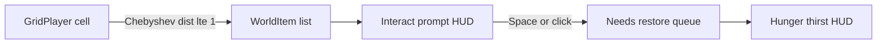

# Nearby objects and first eat/drink

Gameplay stays grid-based. This pass is **look-at + one action**, not inventory.

Objects already on the island (from [`web/src/props.ts`](web/src/props.ts) / [`web/src/models.ts`](web/src/models.ts)):

- `coconutHalf` — open coconut (eat/drink)
- `coconut` — closed
- `pineapple` — needs a knife later
- `orange` — the raw fruit already scattered (Kenney food-kit; treat as “apple/tomato or whatever it is”)



## Prompt UI

New `#interact` panel in [`web/index.html`](web/index.html), stacked above `#hint`, same visual language as the how-to box ([`#hint`](web/src/style.css): translucent dark, rounded, 14px). Unlike the hint, this one **allows pointer events**.

- Always when nearby: object **name**
- If an action exists: a button
  - Enabled: e.g. `Eat / drink` (Space works too)
  - Blocked: button disabled, label like `Open (needs hammer / knife)`
- Hidden when nothing is in range, or on the death screen

Keep `#hint` for controls. Audio unlock in [`web/src/audio.ts`](web/src/audio.ts) must not overwrite this panel.

## What counts as “nearby”

Use player `cellX` / `cellZ` ([`web/src/player.ts`](web/src/player.ts)). An item is in range if Chebyshev distance is **0 or 1** (same cell or any of the 8 neighbors). Food uses `occupy: "none"`, so you can stand on it.

If several items overlap, pick the **nearest** world position; if tied, prefer one with an enabled action.

## World items

When scattering, record a `WorldItem` per placed prop (not just food — user asked for a name on any nearby object):

```ts
type WorldItem = {
  kind: string;
  name: string;
  cellX: number;
  cellZ: number;
  mesh: THREE.Object3D;
  action?: { label: string; blockedReason?: string };
};
```

Display names from a small map (`Palm`, `Rock`, `Open coconut`, …). Food actions:

- Open coconut (`coconutHalf`): Eat / drink → +thirst 0.30, +hunger 0.20
- Orange (`orange`): Eat → +hunger 0.30, +thirst 0.20
- Closed coconut: blocked Open (needs hammer / knife)
- Pineapple: blocked Peel (needs a knife)

Trees, rocks, boats, tools: name only this pass.

`add()` in [`props.ts`](web/src/props.ts) should return the clone and cell so we can push onto `ScatterResult.items`.

## Eat / drink

New restore on [`Needs`](web/src/needs.ts): queue leftover hunger/thirst to add over ~2.5s (constants), still clamped 0–1 and energy cap from food/water. Instant full dump would feel wrong vs “gradually”.

On success: remove mesh from the scene, drop the item from the list, clear the prompt. One item, one use.

Space: listen for `Space` when an enabled action is shown; `preventDefault` so the page does not scroll. Click the button does the same. Ignore if dead.

## Files

- [`web/src/interact.ts`](web/src/interact.ts) (new): nearest item, prompt update, Space/click, eat handler
- [`web/src/props.ts`](web/src/props.ts): `WorldItem[]` on scatter result
- [`web/src/needs.ts`](web/src/needs.ts) + [`web/src/constants.ts`](web/src/constants.ts): restore rates/amounts
- [`web/src/hud.ts`](web/src/hud.ts) or interact module: prompt DOM
- [`web/index.html`](web/index.html), [`web/src/style.css`](web/src/style.css), [`web/src/main.ts`](web/src/main.ts)

Out of scope: inventory, actually using hammer/knife, peeling/opening, multiple actions on one object, tomatoes/apples as extra models (orange covers the raw-fruit case).
