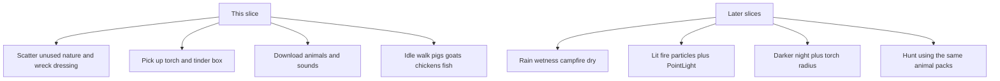

# Island dressing + torch assets

You already have a day/night cycle ([`web/src/dayNight.ts`](Marooned/web/src/dayNight.ts)) and one unlit `campfire-pit` at the hut. The island still uses a small subset of Kenney Nature / Survival / Pirate. This pass fills the map with more of those meshes, adds torch + tinder as **held items only**, and **downloads** animal/fish packs plus CC0 wildlife sounds so hunting is not blocked later.

## Answers to the five questions

**1) Animals (hunting later)** — **Not in the repo today.** Quaternius 150 Nature is plants/rocks only; Kenney food `fish.glb` is a dead fish at the boat. Kenney RPG Audio has no wildlife loops. **This slice downloads the packs** (meshes + clips + CC0 SFX) and may idle-wander a few as dressing. Hunt/kill stays later. Do not fake fauna with food meshes.

**Download (CC0, same vendor layout as existing Quaternius):**
- [Ultimate Animated Animal Pack](https://quaternius.com/packs/ultimateanimatedanimals.html) — 12 animals, walk/idle/attack/death (forest set; we keep the zip even if only some species fit the island)
- [Farm Animal Pack](https://quaternius.com/packs/farmanimal.html) — 7 farm animals with idle/walk/run; **pig, goat, chicken** read as feral livestock off a wreck (on-theme)
- [Animated Fish Pack](https://quaternius.com/packs/animatedfish.html) — 7 aquatic species for the pond
- Skip Kenney Cube Pets (wrong silhouette)

Put zips under `assets/vendor/quaternius/` (e.g. `ultimate-animated-animals/`, `farm-animals/`, `animated-fish/`). Prefer **glTF**. Extend [`scripts/fetch-kenney-assets.py`](Marooned/scripts/fetch-kenney-assets.py) or add a small Quaternius fetch note: Quaternius pages use a Download button (often itch/Drive); if the zip URL is not stable, download once, commit the extracted pack, and log the source URL in [`assets/vendor/kenney/MANIFEST.json`](Marooned/assets/vendor/kenney/MANIFEST.json) style plus [`assets/THIRD_PARTY.md`](Marooned/assets/THIRD_PARTY.md), [`_docs/STACK.md`](Marooned/_docs/STACK.md), [`_docs/MVP.md`](Marooned/_docs/MVP.md) §6.

**Sounds:** Kenney has none. Pull **Freesound CC0 only** (license filter `Creative Commons 0`) into `assets/vendor/freesound/` (or similar): seagulls, tropical birds, pig/boar, chicken, a short splash. Keep existing procedural frogs. No CC-BY without a credits line.

**2) Fire** — **Unlit pits only.** We have:
- Used: Survival `campfire-pit.glb` (hut)
- Unused: Nature `campfire_logs` / `campfire_stones` / `campfire_planks` / `campfire_bricks`; Survival `campfire-stand`
- **No** burning, coals, or ash variants, and no fire audio. Lit fire = our own `PointLight` + particles later. “Burned” can later swap to `campfire_stones` / pit without logs.

**3) Lighter / matches** — **No dedicated mesh.** No BIC, matchbox, or flint in Kenney/Quaternius vendor. Closest on-theme stand-in: Survival `box.glb` / `box-open.glb` as a **tinder box** (marooned-accurate). A Zippo can wait.

**4) Unused assets that make sense now** (on-theme, skip furniture PCs / fantasy swords / cargo liners):
- **Nature:** extra palms, flowers, grass clumps, bush variants, mushrooms, fallen logs, extra rocks
- **Survival:** grass patches, extra logs, bedroll, bucket, bottles, open barrel, extra stones
- **Pirate:** bottles, crate-of-bottles, extra barrels, flags on the wreck, detailed palms
- **Food (island-plausible):** banana (palms), lemon, watermelon — not burgers
- **Skip for now:** modular cave kit (a whole system), farm wheat/corn rows, fantasy cauldrons/coins

**5) Torch + dark night** — One mesh exists: Quaternius [`Torch_Metal.gltf`](Marooned/assets/vendor/quaternius/fantasy-props-megakit/Exports/glTF/Torch_Metal.gltf) (a bit “dungeon,” but it is a torch). No wooden stick-torch. **This slice: place and pick it up** (same as hammer). **Do not** tighten night fog or attach a flashlight — you asked for the asset only. Night already dims hemi/sun; `FOG_NIGHT_SCALE` exists but is not a torch radius.

## What we will build

Keep scatter in [`Marooned/web/src/props.ts`](Marooned/web/src/props.ts) + URL map in [`Marooned/web/src/models.ts`](Marooned/web/src/models.ts). Register names in [`Marooned/web/src/interact.ts`](Marooned/web/src/interact.ts). Torch/tinder reuse existing instant `pickup` / pockets (`HeldKind` += `"torch" | "tinder"`). No eat/break/light actions.

**Nature density (beauty):**
- Flowers (yellow/purple mix) and `grass` / `grass_large` on grass biome, `occupy: "none"` so they do not block walking
- Extra bush variants (`plant_bushSmall`, `plant_bushDetailed`) mixed into the existing bush pass
- Mushrooms in inner grass (shade)
- More fallen logs (`nature log` + existing survival log)
- Extra palm variant (`tree_palm` / `palm-detailed-straight`) on sand
- Extra unlit fire rings: `campfire_logs` or `campfire_stones` on beach (decor, not interact)

**Wreck / hut dressing:**
- Pirate `bottle` / `crate-bottles` / extra `barrel` at wreck
- Survival `bedroll`, `bucket`, `box` (tinder) at hut
- Banana near some palms (pick up later can stay decor-only this pass, or pickup like orange if cheap)

**Held:**
- Torch at hut or wreck — Pick up, pockets, G drop; **unlit mesh, no PointLight**
- Tinder box (`box` / `box-open`) — same; prompt **Tinder** / **Matches**

Scale new Kenney tools/food with longest-edge like existing props so nothing goes boat-sized.

**Animals this slice (living decor, not hunting):**
- After packs land, spawn a handful of pig/goat/chicken on grass with idle + slow walk loops (no aggro, no loot)
- A few fish in the inland pond if the fish pack clips are swim loops
- Optional distant bird/seagull **audio** only if we lack a convincing bird mesh
- Clips stay in vendor so a later hunt slice can add attack/death without another download

## Out of scope

- Rain, wetness HUD, drying at fire
- Burning campfire / torch light / darker night
- Hunt, damage, carcass loot, animal needs
- Stick + rag crafting (no extra meshes needed until we light things)
