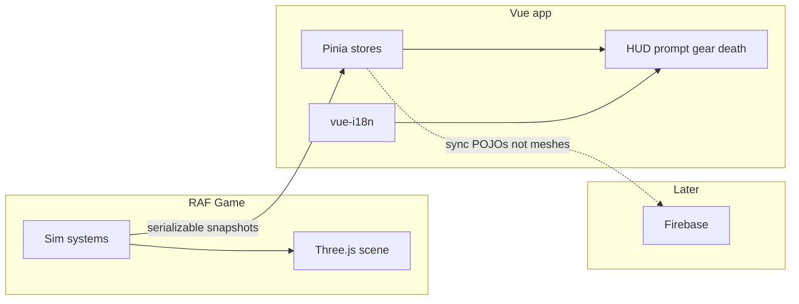
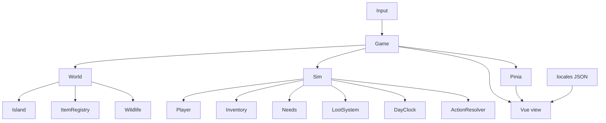

# OOP architecture ideas (Three.js + Vue HUD)

The problem is not “too few classes.” It is **mixed concerns packed into a few large modules**, with **item state living in three places** and **English strings baked into sim code**. ~5.3k lines is still a good size to refactor in place. Do not rewrite the island in R3F.

## Stack verdict

**Keep:** imperative Three.js scene + RAF sim tick ([`main.ts`](Marooned/web/src/main.ts) `frame()`).

**Skip:** React Three Fiber. The sim is grid + `dt` (`player`, `loot`, `needs`, `wildlife`, `day`), not a React tree of meshes. R3F would rewrite [`props.ts`](Marooned/web/src/props.ts) / [`loot.ts`](Marooned/web/src/loot.ts) / [`player.ts`](Marooned/web/src/player.ts) for no gameplay gain.

**HUD / state / i18n:** Vue 3 + **Pinia** + **vue-i18n**, not React. Pinia is a Vue library; using it without Vue is fighting the tool. The canvas stays a sibling of the Vue app (`#game` canvas + `#ui` mount). Vue never owns meshes.

## What is actually messy

Four files do too much:

- [`interact.ts`](Marooned/web/src/interact.ts) (~534): `WorldItem` type, food/tool action rules, Space/1/2/G input, proximity prompt, gear panel, needs restore, loot notify. English labels inline (`"Peel"`, `"too rotten to eat"`).
- [`player.ts`](Marooned/web/src/player.ts) (~468): WASD, grid move, pockets, meal/cut/break locks, camera follow, pose.
- [`props.ts`](Marooned/web/src/props.ts) (~458): landmarks, tree scatter, loot site tagging, runtime `spawn()`.
- [`loot.ts`](Marooned/web/src/loot.ts) (~379): caps, rot timers, Three material tint, food naming.

Name tables are duplicated: [`food.ts`](Marooned/web/src/food.ts) `NOUN` / `formatFoodName`, `interact.ts` `NAMES` / `HELD_NAME`, loot tool names, [`hud.ts`](Marooned/web/src/hud.ts) death copy, [`index.html`](Marooned/web/index.html) hint.

Already decent: [`needs.ts`](Marooned/web/src/needs.ts), [`island.ts`](Marooned/web/src/island.ts), [`dayNight.ts`](Marooned/web/src/dayNight.ts), [`scale.ts`](Marooned/web/src/scale.ts).

## Target object model

Prefer **one owner per fact**. Classes for identity/lifecycle; functions for math.

**Unify item state**

- One `Item`: `{ id, kind, cell, prep, freshness }` plus a mesh held only in the Three registry (not in Pinia).
- Today: `WorldItem` + mesh `userData` + loot `Live`. Loot `Live` should keep **timers only**.
- One kind taxonomy: scenery vs food vs tool (collapse `FoodKind` / `FruitKind` / `HeldKind` overlap).

**Split `GridPlayer`:** `Player` (move), `Inventory` (hands/pockets as ids), `BusyAction` (meal/cut/crack), `Input` (WASD, Space, 1/2/0/G, zoom).

**Split `createInteract`:** `ActionResolver` (pure, returns **locale keys**), `UseItem` (apply), Vue `InteractPrompt` / `GearPanel`.

**Split `props.ts`:** `Landmarks`, `Scatter`, `ItemSpawner`.

**`Game` class:** current `start()` / `frame()`. Each tick: sim → write Pinia snapshots → render Three → Vue reacts.

## I18n — all locales separate

Sim and actions must never contain English (or any language). They emit **keys**; the view translates.

Layout:

- [`Marooned/web/locales/en.json`](Marooned/web/locales/en.json) — source locale, committed, complete
- `locales/cs.json` (etc.) later — same key tree, missing keys fall back to `en`
- Tiny `i18n.ts`: `t(key, params)` wrapping vue-i18n once Vue is mounted; until then the same JSON works with a 20-line lookup so extract can land before Vue

Key design (ICU-style params, not concatenated strings):

- `item.coconut` / `item.coconut_half` / `item.orange` — nouns only
- `food.prep.half`, `food.prep.hole`, `food.state.rotten`, `food.state.poisonous` — composed in the view, not in `formatFoodName`
- `action.eat`, `action.drink`, `action.peel`, `action.slice`, `action.split`, `action.pickup`
- `action.blocked.rotten`, `action.blocked.needKnife`, `action.blocked.needHammer`
- `hud.hint`, `hud.death` (`{hours}`, `{minutes}`), `hud.respawn`
- `gear.hands`, `gear.pocketLeft`, `gear.empty`

`ActionResolver` returns `{ id: "peel", blocked?: "needKnife" }`, never `"Peel (need a knife)"`.

Do **not** translate: `SEED`, asset paths, kind enums, console `[loot]` debug, biome ids.

Default locale `en`; persist choice on `useUiStore` (`locale`). Browser language is a later nicety.

## Pinia — serializable stores, Firebase-ready

Pinia is the **client snapshot of sim state**, not the physics engine and not netcode.

**Put in stores (plain JSON, cloneable, Firestore-shaped):**

- `useSessionStore` — seed, day `t`, survived hours, `alive`
- `useNeedsStore` — thirst, hunger, energy, temp, health (numbers 0–1)
- `usePlayerStore` — `cellX/Z`, gait, `heldKind` (string id, **not** mesh)
- `useInventoryStore` — hands + pockets as `{ kind, prep, freshness } | null`
- `useWorldStore` — ground items `{ id, kind, cell, prep, freshness }[]` (no `Object3D`)
- `useUiStore` — locale, nearby `itemId`, current `actionId`, death overlay

**Never put in Pinia:** `THREE.Object3D`, `AnimationMixer`, WebAudio nodes, `Uint8Array` biomes, loot RNG internals. Those stay in `Game` / `World`. A side map `id → mesh` is the view.

**Write direction:** sim is source of truth this slice (single player). Tick ends with `store.$patch(snapshot)`. Vue HUD is read-only. Later Firebase: apply remote events **into the sim**, then patch stores — do not let two clients fight by writing Pinia independently.

**Multiplayer later (do not build now):**

- Sync **events** (pickup, eat, spawn, cell step) or infrequent snapshots, not 60 fps transforms
- Host or Firestore as authority for `worldItems` + player cells; Pinia remains a cache
- Loot RNG must be seeded per room or server-assigned, or two clients will desync
- Wildlife can stay local until it matters

## Folder layout

- `web/src/game/Game.ts` — loop, store patches
- `web/src/world/` — island, ocean, scatter, items + mesh registry
- `web/src/sim/` — needs, loot, day, actions (locale keys only)
- `web/src/actor/` — player, inventory, wildlife
- `web/src/stores/` — Pinia
- `web/src/view/` — Vue HUD, prompt, gear, death, character select
- `web/locales/*.json` — all user-facing copy
- `web/src/assets/` — model URLs, loaders, scale, audio
- `web/src/input/Input.ts`

`@/` alias stays.

## Order of work (playable after each)

1. Break `props ↔ interact ↔ loot`: `world/item.ts` with no DOM, no player, no strings.
2. Single `Item` truth; loot `Live` = timers only.
3. `ActionResolver` returns keys; `t()` + `locales/en.json` for names, actions, death, hint. Delete `NOUN` / `NAMES` / `formatFoodName` English.
4. Split `GridPlayer` / `Input`.
5. Mount Vue 3 on `#ui`; Pinia stores; Game patches them each tick. Gear/prompt become Vue. Still no R3F.
6. Firebase is a **later** consumer of the same POJOs — not this refactor.

## Explicitly do not do

- R3F / ECS / Godot rewrite in this pass
- React (Pinia implies Vue)
- Classes for `mulberry32`, `fitAndPlant`, biome SDF
- Meshes, audio, or biomes inside Pinia
- Translating inside `formatFoodName` — replace that function with keys + locale templates
- Big-bang move of all 26 files in one PR
- Multiplayer / Firebase wiring until stores are actually serializable and the sim is the writer
