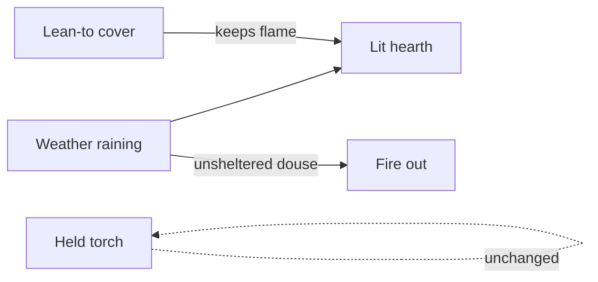

# Fireplace, torch, fishing pole, HUD

Branch [`cursor/fire-rain-shelter-b82d`](https://github.com/davidnekovarcz/marooned) is 5 commits ahead of `main` (night fire, rain, pond drink, empty-hands shore fishing, lean-to, wetness). Work stays on this branch.

## 1. Move the beach stone fireplace off the waves

The problem is the two `campfireStones` rings, not the hut pit. They are planted with `tryPlace("campfireStones", sand, 2, () => true, "none")` in [`web/src/props.ts`](Marooned/web/src/props.ts), so they can sit on wet sand and the ocean mesh washes over them.

- **Keep** the hut `campfire` where it is. Keep `campfireStones` in `HEARTH_KINDS`.
- After the forest circle exists, place **at least one** stone ring on walkable **grass at the forest rim** (~8–11 cells from `forestX`/`forestZ`, not inside a tree).
- If a second ring stays on the beach, require **inland sand**: grass or water must not be an adjacent cell (no wave overlap). Prefer skipping a second beach ring over putting it on the waterline.

## 2. Firewood in the ring (not fireworks)

Stone rings and the hut pit are empty; flames spawn at the mesh origin and rise **1.35 m** with a spinning radius ([`Atmosphere.updateFire`](Marooned/web/src/fx/atmosphere.ts)) — a fountain, and the ocean used to clip the beach ring.

- When spawning `campfire` / `campfireStones`, parent a `campfireLogs` clone into the ring (low Y, small scale) so wood sits in the bowl. Already imported as `campfireLogs` in [`models.ts`](Marooned/web/src/models.ts).
- Particle tweaks for a low burn: origin ~`y + 0.08`, rise **~0.4 m**, radius **0.04–0.12**, slower spin. Keep point-light on the hearth.

## 3. Fishing pole (no vendor rod)

Vendor search: **no fishing-rod mesh** (only `boat-fishing-small` and `campfire-fishing-stand`). Survival kit has hoe/axe/shovel, not a pole.

- Add a small composed mesh (`makeFishingPole()`): long brown cylinder + tiny reel + hanging line. Hold pose like other tools in [`inventory.ts`](Marooned/web/src/actor/inventory.ts).
- New `HeldKind` `"fishingPole"`; place **one** at the fishing boat (next to `fishStand`); pickup like torch.
- [`Actions.context`](Marooned/web/src/sim/actions.ts): `fish` only if `held === "fishingPole"` && `onShore`. Empty hands on shore → `{ id: "fish", blocked: "needPole" }` so the prompt teaches the requirement. Pond drink unchanged.
- Locales: `item.fishingPole`, `action.blocked.needPole`.

## 4. Brighter torch in the dark

Held torch is a single `PointLight` intensity ~**1.6**, distance **11**, decay **1.6**, no shadow ([`atmosphere.ts`](Marooned/web/src/fx/atmosphere.ts)). Night hemi is ~**0.018**, so the pool is tiny and MeshStandard props barely catch it.

- Close light: intensity ~**8–10**, distance ~**18**, decay ~**1.1**, warm `0xffc078`.
- Add a wider fill light (intensity ~**2.5**, distance ~**32**, decay **1**) parented with the torch so ground and nearby props read.
- Torch stays independent of rain (no change to `needs.tick` torch warmth).

## 5. HUD: wet left of food; drink = bottle

[`Hud.vue`](Marooned/web/src/view/Hud.vue) `NEED_ORDER` is currently `energy, thirst, hunger, temperature, wetness, health`. Wet and thirst are both droplets.

New order: **energy, wetness, hunger, thirst, temperature, health**.

Replace the thirst SVG with a simple water-bottle silhouette; keep wet as the droplet. Existing `data-need="thirst"` blue fill stays.

## 6. Near-object hints (animals)

Wildlife is spawn-only ([`wildlife.ts`](Marooned/web/src/wildlife.ts) returns `{ update }`). Interact prompt is hidden unless `actionId`.

- Tag each critter with `kind` (`fox` / `pig` / `deer`). Skip pond fish so they don’t fight Drink / Fish.
- `nearest(cellX, cellZ, max=2)` on the wildlife API.
- In [`Game.ts`](Marooned/web/src/game/Game.ts), if no cook/light/build/pond/fish/held/loot action: show name only (`ui.promptKind`, `actionId = null`).
- [`InteractPrompt.vue`](Marooned/web/src/view/InteractPrompt.vue): visible when `actionId || promptKind`. Locales `item.fox` / `pig` / `deer`.

## 7. Rain puts the fireplace out (torch stays)

[`Weather.raining`](Marooned/web/src/sim/weather.ts) is already `intensity > 0.08`. Fire audio already follows `hearth.lit`.

- `Camp.douse(hearth)` plus each tick: if raining and the hearth cell is **not** `covered()` (lean-to), set `lit = false`. Particles and crackle stop with existing `lit` checks.
- Lighting in unsheltered rain: `{ id: "light", blocked: "tooWet" }`. Under a lean-to, lighting still works.
- Held torch: no douse.

