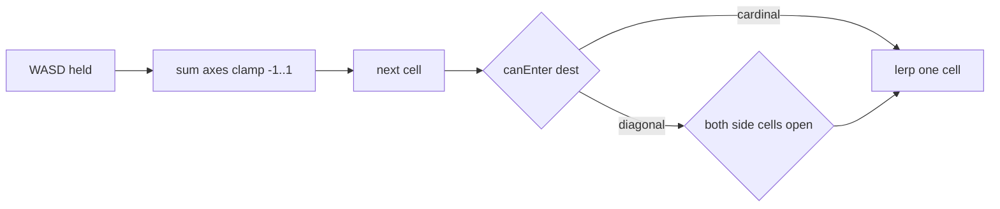

# Movement, crouch, walk feel, audio, Kenney clips

## A) Body-state sounds — we do not have them

Nothing is wired for exhaustion, cold, or heat. [`web/src/audio.ts`](Marooned/web/src/audio.ts) covers ocean/rain/fire plus pickup/eat/drink/cut. [`Needs.tick()`](Marooned/web/src/needs.ts) already flips `canSprint` at energy 0 and tracks `TEMP_COLD` / `TEMP_HOT`, but only the HUD reacts.

| Cue | In game? | Closest unused files |
|-----|----------|----------------------|
| Exhausted “uhff” after sprint | No | OpenGameArt `breath.ogg`, `grunt_01–05.ogg` in `assets/vendor/opengameart/80-cc0-creature-sfx/` |
| Freezing / “třesu se” | No | No shiver/teeth-chatter. `cough_*.ogg` is the nearest (creature, not human) |
| Too hot / “potím se” | No | Nothing named sweat/heat. Steam at the fire is particles only |

Kenney RPG Audio has cloth, footsteps, pots — **no vocals**. There are also **no spoken Czech/English lines** in the repo.

This pass will **not** add those sounds (creature grunts would read as animals). If you want them next, we should fetch short **human** CC0 breaths/shivers, not reuse the creature pack.

---

## D) Kenney-ready animations (official, small set)

Kenney’s character packs (Survivors, Protagonists, Animated Characters 1/3) ship **separate FBX clips** on the same Mixamo-style rig. Official lists:

- **Idle** — used ([`Idle.fbx`](Marooned/web/src/models.ts))
- **Running** — used for **both** walk and run ([`Run.fbx`](Marooned/web/src/models.ts), walk at `WALK_ANIM_SCALE = 0.72`)
- **Jump** (pose) — in the pack, **not copied into the game**
- Each FBX also contains a helper `Root|0.Targeting Pose` (already skipped)

**There is no Kenney Walk, Crouch, Sit, Swim, Eat, or Fish clip.** That is why walk looks like a slow jog and crouch is a homemade bone overlay.

For more clips, the project already points at CC0 [Quaternius Universal Animation Library](https://quaternius.com/packs/universalanimationlibrary.html) (preview: [quaternius.com/animviewer.html](https://quaternius.com/animviewer.html)). Useful names if we retarget later: `Walk`, `Jog_Fwd`, `Sprint`, `Crouch_Idle`, `Crouch_Fwd`, `Swim_Idle`, `Swim_Fwd`, `Sitting_*`, `PickUp_Table`, `Fixing_Kneeling`. UAL 2 adds farming/fishing. Vendor folder only has itch metadata today — the FBXs are not imported.

**Out of scope this pass:** downloading the full UAL / Mixamo library.

---

## B) 8-direction walk/run (grid, still one cell at a time)

Today WASD is **cardinal only**. [`Input`](Marooned/web/src/input/Input.ts) maps each key to one axis; [`GridPlayer.update`](Marooned/web/src/actor/player.ts) takes the **first** pressed key and `break`s. Wildlife already walks 8 ways in [`wildlife.ts`](Marooned/web/src/wildlife.ts).

**Change:**

- Add `Input.moveDir()` that sums held WASD/arrows and clamps each axis to `-1 / 0 / +1`.
- One step to `(cellX + dx, cellZ + dz)` when that cell is `canEnter`.
- Diagonals: also require **both** adjacent cardinal cells walkable (no squeezing through a tree/wreck corner).
- Diagonal duration = `STEP_SECONDS_* * Math.SQRT2` so WA is not faster than W.
- `lookAt` the destination so the body faces between W and A.

Sprint (Shift) and swim timings stay as they are.

---

## C) Crouch spin — fix the overlay, no Kenney crouch clip

Crouch is **not a clip**. During cut/break/work, [`busy.ts`](Marooned/web/src/actor/busy.ts) drives `setCrouch(envelope)` while **Idle keeps playing**. [`applyPose()`](Marooned/web/src/playerModel.ts) then `quaternion.multiply`s fixed Eulers onto Hips/Spine/legs/arms **after** `mixer.update`. Idle sway changes the local axes every frame, so the overlay precesses — that is the spin. Arm Z twists (`±0.55`) and whole-mesh `CROUCH_PITCH` make it worse.

**Fix (procedural, same trigger):**

1. Cache each overlay bone’s quaternion **right after** `mixer.update` (or fade idle weight to ~0 while crouched).
2. Apply crouch as a **slerp from that posed quaternion toward a bind-relative squat**, not a multiply on a moving frame.
3. Drop whole-mesh `CROUCH_PITCH` (keep a small `CROUCH_DROP` only).
4. Soften or remove arm Z twist.

Meals already force `setCrouch(0)` — leave that.

---

## E) Walking feel + camera “shake”

Two separate problems:

**Animation:** walk is the Run clip at 0.72×. After 8-dir, also face the true step (already from B). Extra polish: keep the run/walk action **running across cells** (already true if gait stays walk) and retune `WALK_ANIM_SCALE` / `STEP_SECONDS_WALK` so one cycle is closer to one metre (less foot-slide). Re-extract the Kenney Survivors zip from [`MANIFEST.json`](Marooned/assets/vendor/kenney/MANIFEST.json); if a `Walk.fbx` is actually in that pack, copy it next to `Run.fbx` and play it for gait `walk`. If not (expected), do **not** pull Mixamo/UAL in this pass.

**Camera:** there is no bob. [`followCamera`](Marooned/web/src/actor/player.ts) does `camera.position.lerp(target, 0.12)` **per frame** (faster at 120 Hz) and `lookAt`s the player every frame while the camera still lags. That reads as shake.

**Fix:**

- Exponential follow: `1 - Math.exp(-k * dt)` (same feel at 60 and 120 Hz), softer `k` than `0.12/frame`.
- Lerp a look-at point the same way (do not snap `lookAt` to the body).
- Face steps with `lookAt(to.x, mesh.position.y, to.z)` so the body does not pitch toward Y=0.

---

## Files

- [`web/src/input/Input.ts`](Marooned/web/src/input/Input.ts) — combined move vector
- [`web/src/actor/player.ts`](Marooned/web/src/actor/player.ts) — 8-dir step, facing Y, camera damp
- [`web/src/playerModel.ts`](Marooned/web/src/playerModel.ts) — crouch overlay; optional Walk clip
- [`web/src/constants.ts`](Marooned/web/src/constants.ts) — walk timing / camera follow rate
- [`web/src/models.ts`](Marooned/web/src/models.ts) — only if Walk.fbx exists

No locale or HUD changes.
