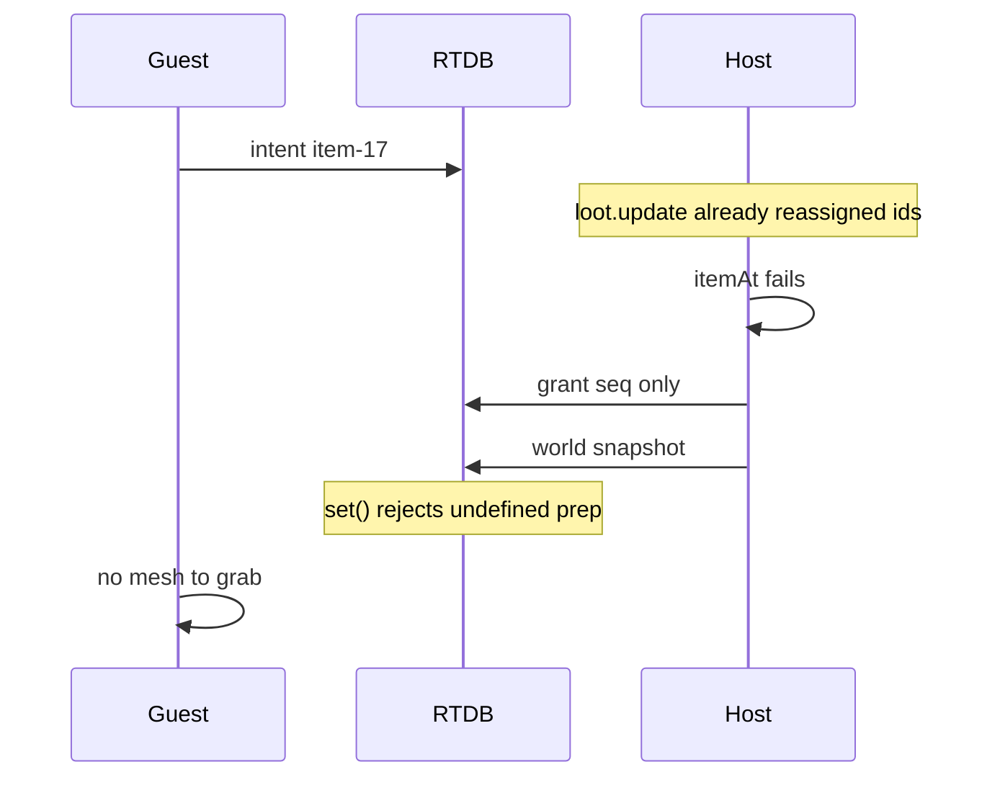

# Fix multiplayer pickup

Live RTDB (`rooms/demo`) shows the failure, not a prompt bug:

- Three players are in the room. Host `JdO8pR91…` (slot 0) is holding an **axe** — local host pickup works.
- Guest `2IFHz8NB…` has `grants/{uid} = { seq: 4 }` with **no `pickup` payload**. Space sent an intent; the host answered “done” without giving the item.
- `/rooms/demo/world` is **null**. The host has never successfully published the shared item list.



## Root cause

[`Item.snapshot()`](Marooned/web/src/world/item.ts) always sends `prep` and `freshness`, which are `undefined` for sticks, stones, tools, etc.:

```58:66:Marooned/web/src/world/item.ts
  snapshot(): ItemSnapshot {
    return {
      id: this.id,
      kind: this.kind,
      cellX: this.cellX,
      cellZ: this.cellZ,
      prep: this.prep,
      freshness: this.freshness,
    };
  }
```

Firebase RTDB `set()` **rejects `undefined`**. [`Room.publishWorld`](Marooned/web/src/net/room.ts) is `void`’d in the loop, so the write dies every 2 Hz and guests never run [`applyNetWorld`](Marooned/web/src/net/worldSync.ts).

Without that snapshot:

- Host runs `loot.update` (new `item-N` ids). Guests do not.
- Guest intent uses a local id the host does not have.
- [`applyHostIntent`](Marooned/web/src/net/hostIntents.ts) hits `if (!item) return { seq }` — empty grant, nothing to grab.

Same `undefined` can also poison a grant when the host *does* find a food item (`snapshot()` still includes the other missing field).

## Fix

1. **Make RTDB payloads JSON-safe** in [`web/src/net/room.ts`](Marooned/web/src/net/room.ts): a small `toRtdb()` (`JSON.parse(JSON.stringify(value))`) used by `publishWorld`, `publishPlayer`, `sendIntent`, `sendGrant`, `saveSurvivor`. Also omit empty `prep`/`freshness` in `Item.snapshot()` so the data is clean even without the helper.

2. **Do not clobber a good grant** in [`applyHostIntent`](Marooned/web/src/net/hostIntents.ts) / host loop:
   - Track last processed `seq` per uid; ignore repeats (`onValue` can redeliver an intent before `intents/{uid}` is deleted).
   - If pickup is requested and the item is missing, **do not** `set` `{seq}` over an existing grant.
   - Fallback: find by **kind + Chebyshev ≤ 1** from the intent cell when `itemId` misses (covers the frames before the first world snapshot).

3. **Guest grant apply** in [`Game.ts`](Marooned/web/src/game/Game.ts): only `grabHeld` when `grant.pickup` is present; ignore seq-only grants.

No protocol change for host-local pickup. After deploy, `/rooms/demo/world` should populate and guest Space pickup should put the mesh in hand.

## Verify

- Confirm RTDB `rooms/demo/world.items` is a non-null array after a host is in the room.
- As a second client, pick up a stick/coconut: grant includes `pickup.id` / `kind`, item leaves the ground, appears in hands/pockets.
- Host still picks up locally (already works).
