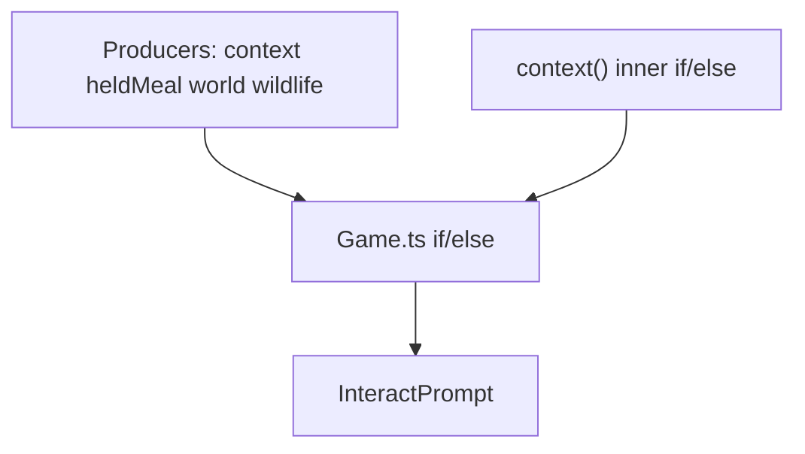

# Interact prompt priority refactor

## What is broken

Space-prompt choice lives in two places that do not match:

- [`Actions.context()`](Marooned/web/src/sim/actions.ts) already picks **one** of cook → light → build → pond → shore fish
- [`Game.ts`](Marooned/web/src/game/Game.ts) then **re-slices** that result against held meal, grounded-fish pickup, other loot, and wildlife

That is why grounded fish had to be a special-case branch, and why a blocked shore Fish can hide nearby loot.

## Chosen priority (today’s Game.ts order)

Until you send pairwise swaps, keep this table exactly:

1. Cook held raw fish at lit fire
2. Light fire (including blocked `tooWet`)
3. Build lean-to
4. Drink pond/river
5. Pick up grounded `fish` / `fishCooked`
6. Held meal (eat / drink coconut / peel / slice / blocked need-tool / rotten)
7. Fish at shore (including blocked `needPole`)
8. Other world actions (pickup / peel / slice / split / open)
9. Wildlife name only (no `actionId`)

Blocked prompts still win over a lower **enabled** action (current behavior: need-pole Fish beats coconut at your feet).

## Suggested improvements (this slice)

- **One picker, many producers.** `context` / `heldMeal` / `world` / wildlife only *emit* candidates. They do not decide the winner.
- **Named rows, not buried ifs.** Grounded-fish-before-eat becomes a row, not a kind check in `Game.ts`.
- **`context()` returns every matching place action**, not the first one. Cook and pond can both exist; the table picks.
- **Leave `Interactor.perform` flag dispatch alone.** This slice is prompt selection only.

## Implementation

Add something like `PromptChoice` + `pickPrompt(candidates)` in [`web/src/sim/actions.ts`](Marooned/web/src/sim/actions.ts) (or a tiny sibling `prompt.ts` if `actions.ts` gets noisy).

Each candidate:

- `band`: one of the nine named rows above
- `action`: `ResolvedAction | null` (wildlife is null)
- `item`, `promptKind`, plus held prep/freshness when the target is the held meal

`pickPrompt` sorts by band index and returns the first present candidate.

[`Game.ts`](Marooned/web/src/game/Game.ts) becomes: gather hearth/shore/items → push candidates → `applyAction` from the winner. Delete the 40-line if/else.

Change `context()` to collect:

- cook if held fish + lit fire
- light if unlit hearth + tinder/torch
- build if hammer + mats + not in water
- pond if `atFreshWater`
- fish if `onShore`

No inner returns that hide later bands.

Keep fake prompt kinds `leanTo` / `pond` / `shore` for labels (out of scope to redesign `InteractPrompt.vue`).

## How to change order later

Reply with pairwise rules (`eat > pond`, `loot > blocked fish`, …). That is a one-line reorder of the band table, not another Game.ts special case.

## Test

- Lit fire + held raw fish → Cook (not Eat)
- Unlit hearth + tinder in rain unsheltered → Light blocked tooWet (not loot)
- Hammer + mats → Build
- In pond with coconut in hand → Drink (not Eat)
- Shore + fish on ground + food in hand → Pickup fish
- Shore + pole, no grounded fish → Fish
- Shore, no pole, coconut at feet → blocked Fish (not Pickup)
- No context, held fruit → Eat
- Nearby stick only → Pickup
- Nearby crab only → wildlife label, Space does nothing
