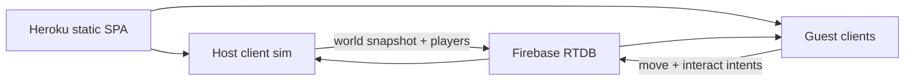

# Shared island (4 players) + Heroku teaser

## Database pick

Use **Firebase Realtime Database**, not Firestore.

- Firestore is a document store; 4 players writing cells 10×/sec will burn the Spark quota and feel laggy.
- RTDB is a JSON tree with `onDisconnect`, presence, and cheap small writes — the right Firebase product for this try.
- Spark plan is free. The Heroku app stays **stateless** (HTML/JS/assets only), as requested.
- PartyKit/Cloudflare would be a nicer game-room later; skip it so we do not add a second live server while Heroku is already hosting the client.

You will create the Firebase project in the console (Anonymous Auth + RTDB). Web config (`apiKey`, `databaseURL`) is public by design; lock writes with rules so only room members can touch `/rooms/{id}`.

## What “shared” means in this try

Same island (`SEED`), **one world**: items, campfires, lean-tos, day/weather elapsed.

- **Host** (first claimed slot) runs the existing `Interactor` / `Loot` / `Camp` / `DayClock` / `Weather` loop.
- **Guests** send movement + Space intents; they do **not** pick up locally.
- **Needs / inventory of your own body** stay on that client once the host confirms the action (eat heals you; you cannot steal a coconut the host already gave to someone else).
- **Wildlife stays local/cosmetic** (not synced) so the first try is not a critter-replication project.

Sim logic stays in [`web/src/sim/useItem.ts`](Marooned/web/src/sim/useItem.ts) / [`Game.ts`](Marooned/web/src/game/Game.ts). Netcode is a new layer, not a rewrite.

---

## Part A — Heroku (from `main`, no DB)

Heroku no longer has a true free hobby dyno. Use an **Eco** dyno (~$5/mo) or whatever credits are on the account. No Heroku Postgres.

Today there is no root `package.json` or `Procfile`. Add a tiny Node static server at the **repo root** (Heroku buildpack cannot `cd web` without a root start script):

- [`Marooned/package.json`](Marooned/package.json) — `postinstall`/`build`: `npm ci --prefix web && npm run build --prefix web`; `start`: `serve -s web/dist -l $PORT`
- [`Marooned/Procfile`](Marooned/Procfile) — `web: npm start`
- `engines.node` matching local Node
- `serve` as a root dependency

Vite already emits a SPA into `web/dist` and pulls models via `@/assets/model/...` so the slug is the built assets, not the whole vendor tree.

Deploy steps (needs your Heroku login):

1. `heroku create marooned-<something>` in the GitHub repo [`davidnekovarcz/marooned`](https://github.com/davidnekovarcz/marooned)
2. Stack: `heroku/nodejs`
3. `git push heroku main:main` (deploy **`main`**, not `cursor/food-in-pockets`)
4. Eco/shared web dyno, no addons
5. Confirm `https://….herokuapp.com` loads the island

If Eco is not enabled on the team, the create/push will fail until billing is on — that is a Heroku account gate, not a code gate.

---

## Part B — Four spawns

Replace the single [`findSpawn`](Marooned/web/src/island.ts) with `findSpawns(biomes): [{x,z} × 4]`:

- Walk the inner grass beach ring (same radius band as today)
- Pick the grass cells closest to the four compass bearings from island center (N/E/S/W)
- Slot `i` always uses spawn `i` so two clients never land on the same cell
- Keep `findSpawn()` as `findSpawns()[0]` so solo play is unchanged when Firebase is missing

---

## Part C — Room protocol (RTDB)

Join via `?room=demo` (default one public room for the try). Anonymous Auth uid = player id.

Tree:

- `/rooms/{roomId}/slots/{0-3}` — `{ uid, connectedAt }` + `onDisconnect` remove
- `/rooms/{roomId}/host` — uid of slot 0’s current holder (re-elect lowest live slot if host drops)
- `/rooms/{roomId}/players/{uid}` — `{ slot, cellX, cellZ, appearance, heldKind, alive }` ~10 Hz from each client
- `/rooms/{roomId}/intents/{uid}` — last `{ seq, interact, pocket }` from guests; host consumes and deletes
- `/rooms/{roomId}/world` — host write: `{ elapsed, weather, items: [{id,kind,cellX,cellZ,prep,freshness}], hearths, shelters }` ~2 Hz (or on mutation)

Security rules: unauthenticated read of world/players; write only if `auth.uid` matches the player path or `host` for `/world`.

Cap 4: if all slots full, show a “island full” overlay (no fifth sim).

New files (keep Game.ts from becoming the net stack):

- [`web/src/net/firebase.ts`](Marooned/web/src/net/firebase.ts) — init from `import.meta.env.VITE_FIREBASE_*`
- [`web/src/net/room.ts`](Marooned/web/src/net/room.ts) — claim slot, presence, host election
- [`web/src/net/protocol.ts`](Marooned/web/src/net/protocol.ts) — snapshot types
- [`web/src/actor/remotePlayer.ts`](Marooned/web/src/actor/remotePlayer.ts) — extra Kenney survivor, lerp to cell, no local input

Solo: if env vars are missing, skip net (today’s game).

---

## Part D — Wire into the existing loop

[`Game.ts`](Marooned/web/src/game/Game.ts):

- After scatter, `Room.join()`; spawn local `GridPlayer` at `spawns[slot]`
- Each remote uid → one `RemotePlayer` (reuse `loadPlayerModel` + their appearance)
- **Host frame:** current `frame()` plus: apply guest intents through `Interactor` targeting that uid’s pawn; publish `/world` + own `/players/{uid}`
- **Guest frame:** move locally; publish position + intents; **do not** run `Loot.update` / camp douse / pickup; apply `/world` onto local `Item[]` / `Camp` (add/remove/move meshes by `item.id`)
- `Item` ids must be stable: assign ids in scatter from the existing seeded order (already a module counter — all clients scatter the same way at boot, then only the host mutates)

Host leave: remaining client with lowest slot becomes host and continues from the last `/world` snapshot (good enough for a try; not a consensus protocol).

Firebase config on Heroku: `heroku config:set VITE_FIREBASE_API_KEY=…` **before** a rebuild so Vite inlines them. Add a `config:set` note in the PR, not secrets in git.

---

## Out of scope for this try

- Persistence when the room is empty
- Shared wildlife AI
- Anti-cheat beyond host authority
- Voice / chat
- Firestore
- Merging this into the food-in-pockets PR; new branch from `main` (e.g. `cursor/multiplayer-4p`)

---

## Try order

1. Heroku `main` live (single player in the browser)
2. Firebase project + env
3. Spawns + ghost avatars + slots (can walk around together even before shared loot)
4. Host-authoritative items/fire/clock
5. Two browsers on the Heroku URL with `?room=demo`
