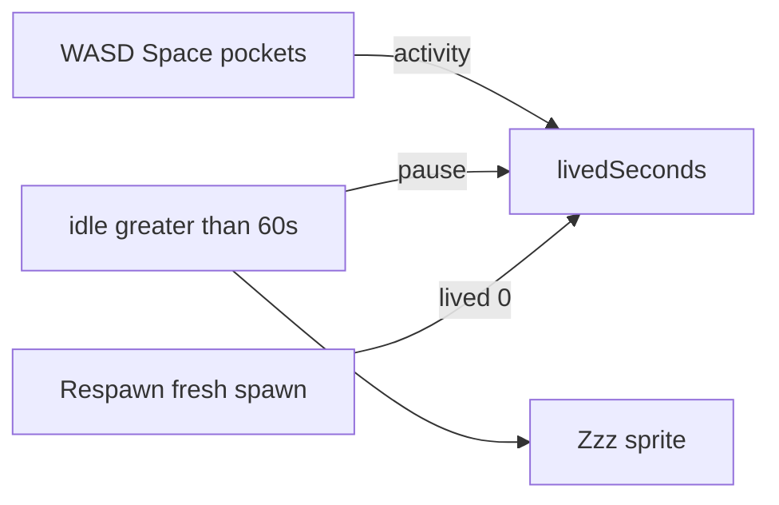

# AFK Zzz and personal survival clock

Today [`DayClock.survivedGameHours()`](Marooned/web/src/dayNight.ts) is **island elapsed** (`day.elapsed` from the shared world). The death screen uses that, so a refresh or a long-lived room inflates “you survived,” and **Respawn does not zero it** (world time keeps going).

Keep `day.t` / HUD clock as island time. Add a **personal** `livedSeconds` that only ticks while this body is alive and not AFK.

## Personal lived time

- Accumulate `livedSeconds` in [`Game.ts`](Marooned/web/src/game/Game.ts) each frame: `if (player.alive && !afk) livedSeconds += dt`.
- Persist on [`NetSurvivor`](Marooned/web/src/net/survivor.ts) as `livedSeconds` (restore on join if `saved.alive`). `deathHours` stays island-hours for the death copy, but **compute it from `livedSeconds`**, not `day.elapsed`: `(livedSeconds / DAY_SECONDS) * 24`.
- [`patchStores`](Marooned/web/src/game/Game.ts) `session.survivedHours` from lived, not `day.survivedGameHours()`.
- **Respawn:** existing `markForceRespawn()` + reload already skips `loadSurvivor`. New body → `livedSeconds = 0`. Dead-but-not-respawned reload still shows `saved.deathHours`.

Needs (hunger/thirst) keep ticking while AFK so standing still is not a freeze-cheat.

## AFK after 1 minute

- Track `lastInput` from real controls: `input.moveDir()`, `consumeInteract` / UI interact, `consumePocket`. Busy work that started from Space already bumped activity.
- `AFK_SECONDS = 60`. When `now - lastInput >= 60` and alive: `afk = true`, pause lived, show Zzz. Any input clears AFK immediately.

## Zzz over the head

Small canvas `Sprite` (~2 m up) on **local** `player.mesh` and on remotes. Same HUD chip look. No nametag/chat in this slice.

Publish `afk?: boolean` on [`NetPlayer`](Marooned/web/src/net/protocol.ts) (omit when false; `toRtdb` strips undefined). [`RemotePlayer.apply`](Marooned/web/src/actor/remotePlayer.ts) toggles the sprite from `net.afk`. Rules unchanged (`players/$uid` self-write).

Solo: local Zzz only.

## Verify

- Stand still 60s: Zzz on you; other browser sees Zzz; death “survived” stops growing. Walk: Zzz gone, counter resumes.
- Die, Respawn: new look, survived time starts at 0.
- Refresh while alive: lived time continues (persisted), island clock still the shared one.
