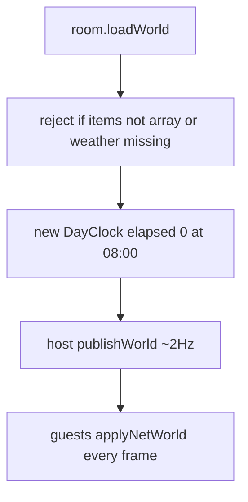

# Fix rain never arriving, and the clock freezing

Rain is scheduled, but a typical `?room=demo` session almost never hits a window. Multiplayer can also **reset** the island to that dry day-0 start, or **freeze** clock and weather when a guest has a world snapshot the host is not updating.

## Why it stays sunny

[`Weather.update`](Marooned/web/src/sim/weather.ts) only rains inside `windowsForDay(dayIndex)`:

- **Day 0:** no rain (`dayIndex < 1`)
- **Even days:** no rain
- **Odd days:** one short afternoon shower `14:20–16:00` (~36 real seconds)
- **Days 3, 7, …:** night storm `20:30–22:24` instead

`DAY_SECONDS` is 480s. Spawn is 08:00. First possible rain is **after a full day plus 08:00→14:20** (~10 minutes), then sun for the next even day. Easy to call “always sunny.”

Solo uses the same schedule (`hosting = !room || room.isHost`). Multiplayer makes it worse:

[`Room.loadWorld`](Marooned/web/src/net/room.ts) returns `null` unless `Array.isArray(val.items) && val.weather`. RTDB often stores lists as objects; older `/world` rows may omit `weather`. The new **host then ticks from elapsed 0 and overwrites** the room. Guests never simulate weather while any snapshot exists — they copy the host, so they stay dry too.

AFK did not cause this: host still calls `weather.update` / `day.update`.

## Why the clock freezes

Guests only tick locally when `latestWorld()` is **null**. If `/world` exists, every frame [`applyNetWorld`](Marooned/web/src/net/worldSync.ts) copies `day.elapsed` / `day.t` / weather and **does not** call `day.update`. Time only moves when the host publishes (~2 Hz).

The snapshot can sit still while the HUD looks frozen:

- `publishWorld` fails (payload / rules) — world node remains, values never change
- Host tab backgrounded or rAF paused — host stops publishing
- Host left; lowest slot has not become host yet — leftover `/world` is applied forever
- Previous 08:00 fix only covered “no world node”; stale world is the remaining hole

Same path freezes rain: guests copy a dry, unchanging snapshot.

## Fix

1. **Hydrate a partial world** in `loadWorld`: accept object-shaped `items` (same `asArray` as [`applyNetWorld`](Marooned/web/src/net/worldSync.ts)); do not require `weather`. If the snapshot has `elapsed` / `dayT`, use it.

2. **Do not clobber a live room** in [`Game.ts`](Marooned/web/src/game/Game.ts): if boot `loadWorld` was null, apply `room.latestWorld()` once it arrives **before the first `publishWorld`**, so a new host cannot wipe a raining island with a fresh day 0.

3. **Guests keep time moving when the host snapshot is stale.** Always apply items/hearths from net. Snap clock/weather only when `world.elapsed` is **ahead of** local `day.elapsed`. Otherwise call `day.update` + `weather.update` (same as the no-world branch). Do not jump backward if the host is behind.

4. **Let a session actually see rain** in `windowsForDay`: drop the day-0 skip and the even-day skip. Keep the existing afternoon window; keep the night storm every fourth day. A fresh 08:00 spawn then rains in ~2 minutes (14:20), not ~10.

No protocol change. HUD `sky` already switches to rain/storm from `weather.raining` / `storm`.
