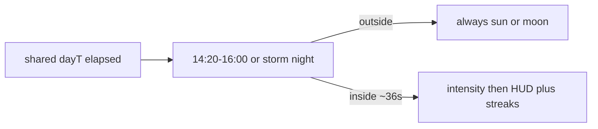

# Rain you can actually see, then remote presence

## Why you still see no rain

The code path is live (host `weather.update`, HUD `sky`, [`Atmosphere.setRain`](Marooned/web/src/fx/atmosphere.ts)). The schedule is the problem.

[`windowsForDay`](Marooned/web/src/sim/weather.ts) still only opens:

- **Most days:** `14:20–16:00` (~36 real seconds)
- **Every 4th day:** **only** `20:30–22:24` (no afternoon shower)

`?room=demo` uses the **shared** `day.t` / `elapsed`, not your spawn. If the room clock is 08:00, 17:00, or 23:00, there is no rain. Waiting ~2 minutes after *you* spawn does nothing unless the island clock is already inside that window. Storm days are dry all afternoon.

## Fix rain first

In [`windowsForDay`](Marooned/web/src/sim/weather.ts):

- **Every day:** afternoon shower **and** a second window (e.g. `09:30–11:00` and `14:20–16:30`) so morning and afternoon sessions both get rain (~2 minutes of rain per day, not 36 seconds).
- **Storm days:** keep those showers **plus** the night storm `20:30–22:40` (do not replace the afternoon).
- Leave ramp / particles / HUD as they are.

No protocol change. After deploy, if the HUD clock is inside a window you should see the rain icon and streaks within a few seconds of ramp-in.

## Next slice: see other survivors

[`TODOs.md`](Marooned/TODOs.md) “Next on the web teaser” and your call: **held mesh + nametag + Enter say**. `heldKind` and `name` are already on [`NetPlayer`](Marooned/web/src/net/protocol.ts). [`RemotePlayer`](Marooned/web/src/actor/remotePlayer.ts) still only lerps the body.

1. **Held mesh:** export grip placement from inventory; `cloneHeld(kind)` from scatter templates (do not `spawn()` a second world item). `RemotePlayer.apply` swaps the grip when `net.heldKind` changes.
2. **Nametag:** already have screen-space chips in [`playerChip.ts`](Marooned/web/src/fx/playerChip.ts). Add an optional second line for the held item label (`formatItemLabel`). Local player: name or sleep face only (Gear already shows your hands).
3. **Say bubble:** Enter opens a tiny compose field (pause WASD/Space). Enter sends one line (max 72). `say` + `sayAt` on `NetPlayer` (omit when idle). Chip or sprite above the name for ~5s. Escape cancels. No log, no queue.

After that, leftover teaser bugs: missing `/world` write, stale slots when a tab dies before `onDisconnect`.
