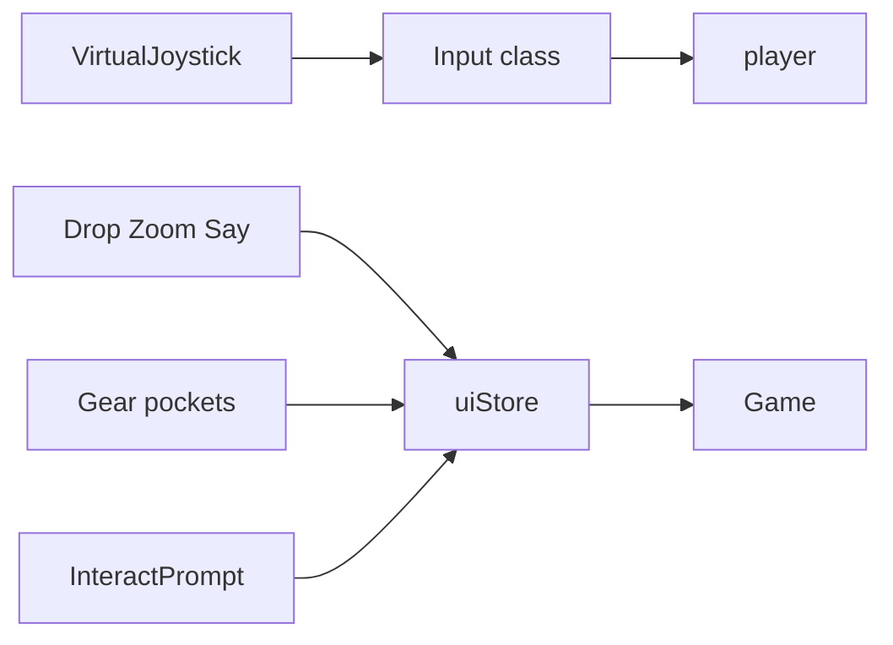

# Mobile touch controls

## Already works on touch

- [Gear.vue](Marooned/web/src/view/Gear.vue): Hands / Left / Right already call `ui.queuePocket(...)`.
- [InteractPrompt.vue](Marooned/web/src/view/InteractPrompt.vue): action button already calls `ui.queueInteract()` (covers Space).
- Character select, death Respawn, say compose input are already pointer-friendly.

## Gaps

- WASD / arrows need a virtual joystick that feeds the same `{x,z}` grid steps as [Input.moveDir](Marooned/web/src/input/Input.ts).
- Shift run becomes outer stick ring (magnitude past ~0.65 sets `sprinting`).
- G drop needs a visible Drop control calling `ui.queuePocket('drop')`.
- +/- zoom needs hold buttons that set `input.zoomDir`.
- Enter say needs a Say button that opens compose via a new `ui.queueOpenChat`.

## Approach

1. **Extend [Input.ts](Marooned/web/src/input/Input.ts)** with a virtual layer that merges with keyboard:
   - `setVirtualMove(dir | null)` and `setVirtualSprint(bool)`
   - `setZoomDir(n)` for pad hold
   - `moveDir()` / `sprinting` / `zoomDir` prefer virtual when active, else keyboard
   - Clear virtual move on pointer cancel / compose

2. **New [MobileControls.vue](Marooned/web/src/view/MobileControls.vue)** (shown only when `matchMedia('(pointer: coarse)')` or touch capability):
   - **Bottom-left:** classic joystick (base + knob). Pointer capture; map angle to the same camera-relative 8 dirs as WASD. Dead zone in the center. Outer ring = sprint.
   - **Bottom-right:** compact stack — Drop, Zoom minus / plus, Say.
   - Mount in [App.vue](Marooned/web/src/view/App.vue); hide when dead / island full / character gate (`body.gate`).

3. **Wire Game boot** so MobileControls can call into the live `Input` instance via a small binder (e.g. `bindMobileInput(input)`), without a second input path.

4. **UI store:** add `chatOpenQueued` plus `queueOpenChat` / `consumeOpenChat`. Game already drains open-chat each frame — also drain the store flag.

5. **Layout CSS** in [style.css](Marooned/web/src/style.css) under `@media (pointer: coarse)`:
   - Lift `#gear` above the stick
   - Lift `#interact` / `#say-compose` so they clear the right pads
   - Larger tap targets on gear slots and interact button
   - `touch-action: none` on joystick and canvas

6. **Hint:** on coarse pointers, shorten the keyboard chord hint in [en.json](Marooned/web/locales/en.json) / Hint.vue so it does not imply WASD-only.

## Non-goals

- Free-analog (non-grid) movement
- Separate on-screen Sprint button (stick outer ring covers it)
- Reworking desktop keyboard flow

## Verify

- Phone or Chrome device mode: walk 8 dirs, sprint on outer stick, interact via prompt, pocket swap via Gear, Drop empties hands, zoom pads work, Say opens compose, AFK clears when stick moves.
