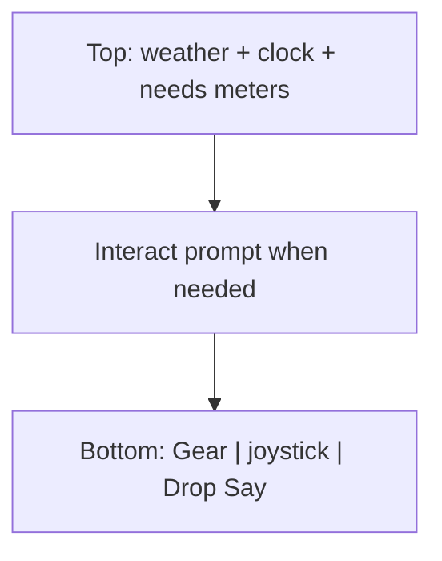

# Mobile HUD rearrange

Feedback-driven layout tweaks on the existing `cursor/mobile-touch-controls` branch. Desktop stays as-is.

## Target mobile layout

1. **Hide instructions** — `body.mobile-ui #hint { display: none }` (unlocked audio already happened via first tap).

2. **Stats with weather/clock** — Wrap `#hud-world` and `#hud-needs` in a `#hud-bar` in [Hud.vue](Marooned/web/src/view/Hud.vue).
   - Desktop: `#hud-bar { display: contents }` so current top-right clock and bottom-right needs keep working.
   - Mobile: `#hud-bar` is one fixed top row (safe-area aware): weather, clock, then the six need icons (slightly smaller). Needs leave the bottom entirely.

3. **No zoom on mobile** — Remove Zoom −/+ from [MobileControls.vue](Marooned/web/src/view/MobileControls.vue) (and related handlers/CSS).
   - When `mobile-ui` is on, snap [CameraZoom](Marooned/web/src/cameraZoom.ts) to `ZOOM_CELLS_IN` (10) and ignore `input.zoomDir` in [Game.ts](Marooned/web/src/game/Game.ts) (watch via existing `watchMobileUi` / `isMobileUi`).
   - Leaving mobile UI restores normal zoom behavior without forcing a zoom-out.

4. **Bottom row** — CSS only under `body.mobile-ui`:
   - `#gear` bottom-left
   - `.mobile-stick` bottom-center (`left: 50%; transform: translate(-50%, 0)`)
   - `#mobile-pads` bottom-right with only Drop + Say stacked
   - `#interact` / `#say-compose` sit above that row so they do not cover the stick

## Files

- [web/src/view/Hud.vue](Marooned/web/src/view/Hud.vue) — `#hud-bar` wrapper
- [web/src/view/MobileControls.vue](Marooned/web/src/view/MobileControls.vue) — drop zoom pads
- [web/src/style.css](Marooned/web/src/style.css) — mobile top bar + bottom triad; hide hint
- [web/src/game/Game.ts](Marooned/web/src/game/Game.ts) — lock zoom while mobile-ui

## Verify

- Phone / device mode: no hint; one top strip with moon/sun, time, needs; bottom is inventory | stick | Drop/Say; no +/-; camera stays fully zoomed in.
- Desktop wide: hint, bottom needs, and keyboard zoom unchanged.
