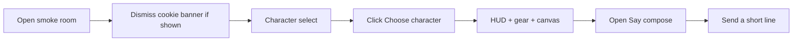

# Kaloko smoke tests for Marooned

## Security first

You pasted a live `KALOKO_TOKEN` in chat. **Do not commit it.** Put it only in a gitignored `.env` (or `~/.config/kaloko/.env`). Prefer rotating that token after this experiment if the chat may be retained.

## Install and init (repo root)

Work in [`/Users/dave/Development/_GameDev/Marooned`](/Users/dave/Development/_GameDev/Marooned) (not only `web/`), so `kaloko.config.yml` and `qa/` live next to the Heroku/root scripts:

```bash
npm install --save-dev kaloko
npx kaloko init --agent claude --org plexima-io --project marooned --project-name "Marooned"
npx kaloko doctor
```

Expected artifacts:

- [`kaloko.config.yml`](kaloko.config.yml) — `org: plexima-io`
- `.claude/skills/kaloko/` — agent skill + acceptance reference
- Draft flow under `qa/flows/` (init may propose one; we will replace/sharpen)

Auth for share/CI:

```bash
# .env (gitignored) — never staged
KALOKO_TOKEN=kal_…
```

`npx kaloko login` is fine for interactive browser auth; the provided token is enough for CLI/share without login if `token_env: KALOKO_TOKEN` is set (default in the template).

## Config tweaks after init

Edit [`kaloko.config.yml`](kaloko.config.yml):

- `org: plexima-io`, `project: marooned`
- `environments.local.base_url.default: http://localhost:5173` (Vite in [`web/vite.config.ts`](web/vite.config.ts))
- Optional `environments.production.base_url: https://marooned-island-e8bc6f06ff39.herokuapp.com` with `readonly: true` for later health walks
- Drop or ignore Mailpit blocks (game has no e-mail)
- Keep `scenarios:` pointing at `qa/flows/*.yml`

Ensure [`.gitignore`](.gitignore) covers `.env`, `tmp/kaloko/`, and any Kaloko run caches.

Optional root scripts for convenience:

- `"kaloko:doctor": "kaloko doctor"`
- `"kaloko:smoke": "kaloko start --scenario qa/flows/smoke-boot.yml --env local && kaloko walk && kaloko evaluate"`

## Scenarios (first experiment)

Target the Vue DOM around the Three.js canvas (reliable Playwright). Use a dedicated room so demo slots/ghosts do not block: `/?room=kaloko-smoke`.



**1. [`qa/flows/smoke-boot.yml`](qa/flows/smoke-boot.yml)** — boot not broken

- Path: `/?room=kaloko-smoke`
- Steps: clear site storage (or fresh context) → if `#cookie-banner` visible, Accept → assert `#character-play` → click Choose character → assert `#character` hidden / `#hud-bar` + `#gear` + `#game` present
- Deterministic criteria on those selectors; skip flaky canvas pixel checks

**2. [`qa/flows/smoke-say.yml`](qa/flows/smoke-say.yml)** — chat UI

- Continues after boot (or embeds a short boot setup in the first step script)
- Press Enter / open Say → `#say-compose` / `#say-input` → type `Kaloko smoke` → send → compose hidden (and optional `.player-chip-say` if still visible)

**3. [`qa/flows/smoke-mobile.yml`](qa/flows/smoke-mobile.yml)** — phone chrome

- Viewport ~390×844; after boot assert mobile UI (`body.mobile-ui` / `#mobile-controls` or toolbar from [`MobileControls.vue`](web/src/view/MobileControls.vue) / [`MobileToolbar.vue`](web/src/view/MobileToolbar.vue))

Step scripts as small Playwright modules under `qa/flows/steps/` (or paths Kaloko init expects), using stable ids already in the DOM (`#character-play`, `#hud-bar`, `#gear`, `#say-compose`) — no new `data-testid` required for v1.

Acceptance notes: short `qa/flows/ACCEPTANCE-smoke.md` describing the three flows for the canvas/reviewers.

## Local run loop

1. Start Vite: `npm run dev --prefix web` (port 5173)
2. `npx kaloko validate qa/flows/smoke-boot.yml`
3. `npx kaloko start --scenario qa/flows/smoke-boot.yml --env local`
4. `npx kaloko walk && npx kaloko evaluate`
5. `npx kaloko preview` (local canvas) then `npx kaloko share` once doctor + walk look good

Repeat for say + mobile once boot is green.

## Out of scope for this experiment

- Wiring GitHub Actions CI yet (token ready in `.env` / later GH secret `KALOKO_TOKEN`)
- Firebase multiplayer two-browser scenarios
- Walking the Heroku production env until local smoke is stable
- Committing secrets or rotating without your go-ahead

## Done means

- `kaloko` is a root devDependency; `kaloko.config.yml` has `plexima-io` + local `:5173`
- 2–3 smoke flows validate and walk green against local Vite
- At least one run shared to the org canvas (if token works)
- Token only in gitignored env; PR/branch can include config + `qa/` without secrets
