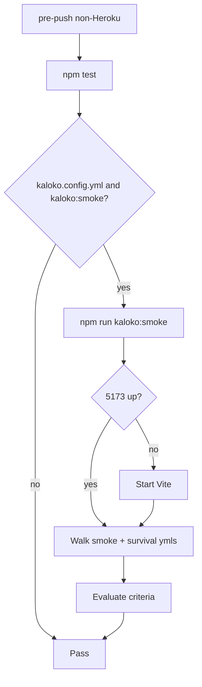

# Kaloko in git-hooks + Marooned survival scenarios

## Why a QA harness (locked)

Keyboard-only walks to wreck/hut are flaky (already called out of smoke scope). Practical survival E2E needs a **gated test API** so Kaloko can teleport, give items, and force weather/needs — then assert the same DOM the player sees (`#interact-action`, `#gear`, `#hud-weather`, `#death`).

Gate: URL `?qa=1` only (never on production Heroku unless someone adds the query). No secret tokens in the page.

## 1) Shared git-hooks (`~/Development/__git-hooks` → davidnekovarcz/git-hooks)

Capability-based, no Marooned name checks.

### Detect

```bash
has_kaloko() {
  [ -f "kaloko.config.yml" ] && { has_npm_script kaloko:smoke || has_npm_script kaloko; }
}
```

### [`shared/quality-checks.sh`](/Users/dave/Development/__git-hooks/shared/quality-checks.sh)

Add `run_kaloko_if_available`:

- If `! has_kaloko` → skip (silent or one-line “no Kaloko”)
- Prefer `npm run kaloko:smoke` when that script exists
- Else `npx kaloko` is not enough alone — skip unless a project script exists
- On failure → block push (same as `npm test`)

### [`pre-push`](/Users/dave/Development/__git-hooks/pre-push)

After `run_tests` on non-Heroku pushes, call `run_kaloko_if_available`. Skip Kaloko on Heroku pushes (same as unit tests).

Update [`README.md`](/Users/dave/Development/__git-hooks/README.md): “if `kaloko.config.yml` + `kaloko:smoke` script, pre-push runs it.”

Publish: commit/PR to **davidnekovarcz/git-hooks**, force-align **smarlify/git-hooks**, re-apply into Marooned [`.githooks`](/Users/dave/Development/_GameDev/Marooned/.githooks).

## 2) Marooned self-contained smoke script

Add [`scripts/kaloko-smoke.sh`](/Users/dave/Development/_GameDev/Marooned/scripts/kaloko-smoke.sh) + root `"kaloko:smoke"`:

1. If `http://localhost:5173` is down, start `npm run dev --prefix web` in the background and wait for 200
2. Walk **all** `qa/flows/smoke-*.yml` and `qa/flows/survival-*.yml` (start → walk → evaluate each)
3. Tear down Vite only if this script started it
4. Exit non-zero on any failed walk/eval

Hooks then only need `npm run kaloko:smoke` — works whether or not the developer already has Vite open.

## 3) Gated QA harness in the game

New module e.g. [`web/src/qa/harness.ts`](/Users/dave/Development/_GameDev/Marooned/web/src/qa/harness.ts), installed from `Game.boot` when `?qa=1`:

```ts
window.__maroonedQa = {
  teleport(cellX, cellZ),
  give(kind),           // into hands / free pocket
  setNeeds(partial),    // hunger, thirst, health, wetness, temperature
  setRaining(boolean),  // or setDayProgress(t) via weather/day APIs
  interact(),           // queueInteract
}
```

Wire into existing systems ([`Game.ts`](/Users/dave/Development/_GameDev/Marooned/web/src/game/Game.ts), player cell, inventory, [`needs.ts`](/Users/dave/Development/_GameDev/Marooned/web/src/needs.ts), [`weather.ts`](/Users/dave/Development/_GameDev/Marooned/web/src/sim/weather.ts) / camp). Prefer calling the same code paths as gameplay (so tests catch real bugs).

Kaloko helpers: after boot with `/?room=kaloko-survival&qa=1`, `page.evaluate(() => window.__maroonedQa…)`.

## 4) New survival scenarios

Reuse boot helpers from [`qa/flows/steps/helpers.mjs`](/Users/dave/Development/_GameDev/Marooned/qa/flows/steps/helpers.mjs); extend with QA helpers.

| Flow | Script outline | Assert |
|------|----------------|--------|
| [`qa/flows/survival-fish.yml`](/Users/dave/Development/_GameDev/Marooned/qa/flows/survival-fish.yml) | Teleport near wreck pole → `#interact-action` Pick up → teleport shore → Fish → wait ~5s | Gear shows fishing pole then fish (or `#interact-name` / gear text) |
| [`qa/flows/survival-fire.yml`](/Users/dave/Development/_GameDev/Marooned/qa/flows/survival-fire.yml) | `setRaining(false)` → give tinder or teleport hut tinder → teleport hearth → Light fire | Interact not `tooWet`; fire lit signal (prompt change / session/UI / no blocked light) |
| [`qa/flows/survival-death.yml`](/Users/dave/Development/_GameDev/Marooned/qa/flows/survival-death.yml) | `setNeeds` hunger/thirst/health drain path **or** teleport+eat poison mushroom | `#death` visible within tens of seconds (not 10+ min idle) |

Update [`qa/flows/ACCEPTANCE-smoke.md`](/Users/dave/Development/_GameDev/Marooned/qa/flows/ACCEPTANCE-smoke.md) (or add `ACCEPTANCE-survival.md`) with purposes/criteria.

**NTH — meet others by the fire:** defer. Needs two sessions / Firebase; outline only in acceptance docs as future `sessions:` scenario, not in this delivery.

Landmark offsets (from props): pole `wreck+(2,-1)`, hut campfire `hut+(-2,+1)`, hut tinder `hut+(1,+1)` — QA can read cells from `#hud-clock[data-cell]` after teleport, or hardcode once harness exposes “teleportToLandmark('wreckPole')” for stability across island seed.

Prefer **landmark helpers on `__maroonedQa`** (`goLandmark('fishingPole'|'hutFire'|'hutTinder'|'boatFish')`) so scenarios don’t hardcode fragile grid math.

## 5) Flow



## Out of scope

- Multiplayer “meet by fire” automation (NTH / later)
- Running Kaloko on pre-commit (too slow)
- Sharing every push to kaloko.app (local walk/eval only in hooks)
- Ungated cheats on production without `?qa=1`
