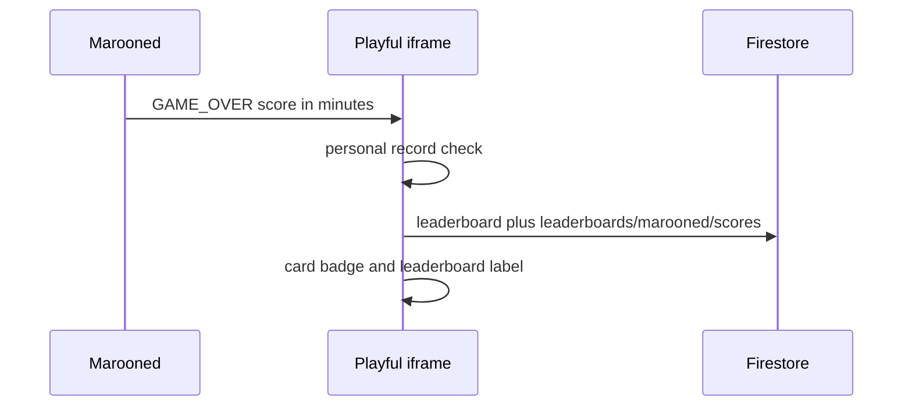

# Survival time as Marooned high score

Death already stores island time in [`web/src/game/Game.ts`](/Users/dave/Development/_GameDev/Marooned/web/src/game/Game.ts) (`ui.deathHours = livedHoursFromSeconds(livedSeconds)`). Playful only records a score when an iframe posts `{ type: 'GAME_OVER', score }`, which Crossy Road and Traffic Run already do. Marooned does not.

## Marooned

In the fresh-death branch of [`web/src/game/Game.ts`](/Users/dave/Development/_GameDev/Marooned/web/src/game/Game.ts) (health hits 0), if the page is inside an iframe, post once:

- `type: 'GAME_OVER'`
- `gameName: 'Marooned'`
- `score`: whole island minutes (`Math.floor(deathHours * 60)`)

Do not post again when a saved dead survivor is restored. That would resubmit the same run on every refresh. Target origin `*`, matching Crossy Road and Traffic Run.

## Playful

The listener in [`src/components/GameIframe.tsx`](/Users/dave/Development/_Smarlify/Playful.Smarlify.co/_Playful/src/components/GameIframe.tsx) already opens the name popup on a personal record and writes the hub `leaderboard` collection. Add display and the card badge:

- One formatter, used by [`Leaderboard.tsx`](/Users/dave/Development/_Smarlify/Playful.Smarlify.co/_Playful/src/components/Leaderboard.tsx), [`LeaderboardPopup.tsx`](/Users/dave/Development/_Smarlify/Playful.Smarlify.co/_Playful/src/components/LeaderboardPopup.tsx), and the card: minutes become `2h 15m`, caption “Time survived”.
- When that submit is for Marooned, also write `leaderboards/marooned/scores` (`name`, `score`, `createdAt`) in the shared `smarlify-api` project. That is the collection [`leaderboardClient.ts`](/Users/dave/Development/_Smarlify/Playful.Smarlify.co/_Playful/src/lib/leaderboardClient.ts) already reads for the other games. Extend `GameId` with `'marooned'`.
- [`GameCard.tsx`](/Users/dave/Development/_Smarlify/Playful.Smarlify.co/_Playful/src/components/GameCard.tsx): include `marooned` in `shouldShowTopScore` and show the formatted time instead of the raw minute count.

Marooned keeps its own Firebase project. The Playful web client credential stays out of this repo.

## Daytime thumbnail

Replace [`public/game-assets/marooned.png`](/Users/dave/Development/_Smarlify/Playful.Smarlify.co/_Playful/public/game-assets/marooned.png). The island day starts at 08:00 and noon is about 80 seconds of real time later (`DAY_SECONDS` is 8 minutes). Wait until the clock is near 12:00, zoom out enough to show the survivor, beach, and wreck in daylight, hide the controls hint, and save a clean 16:9 PNG.

## Check

Local Playful: card badge query does not throw for `marooned`. A death inside `/marooned` posts a numeric score the parent accepts. No commit or Heroku deploy unless you ask.
