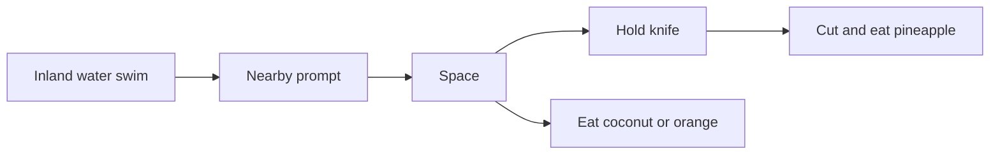

# Kenney mechanics: pickup, hold, swim, knife

Keep the Kenney survivor mesh. Kenney still only has idle / run / jump, so **new clips are poses on that rig** (hand attach, crouch/reach, swim overlay), not a Mixamo dump and not a swap to the UAL mannequin.

Space stays the one action key.

## 1) Picking up things

One **held item** on [`GridPlayer`](web/src/player.ts) (`heldKind` + mesh parented to `leftHand`). It stays after the pickup pose — unlike today’s meal `held`, which is destroyed when eating ends.

This pass: **knife only** (wreck + scattered knives already in [`web/src/props.ts`](web/src/props.ts)). Hammer/axe/food-as-inventory wait.

- Nearby knife: prompt **Pick up**, Space enabled.
- Short reach/crouch (reuse the eat envelope, ~0.5–1s), `hand.attach(mesh)`, splice from `WorldItem[]`.
- Walk / run / idle with the knife in hand.
- Already holding a knife: Space on another knife **swaps** (old mesh dropped back on the current cell, or removed — drop-on-cell is nicer if cheap).

[`web/src/interact.ts`](web/src/interact.ts): actions gain `pickup?: "knife"` (and later other kinds). `perform()` branches pickup vs meal vs cut.

## 2) Eating / holding an object

Open coconut and orange stay eat-on-Space. During the 3s lock:

- Face the item, crouch, put **that food** in the left hand, then remove it.
- If a knife is held, **hide the knife mesh** for the meal and show it again after (one hand).

No Kenney eat clip — this *is* the eating animation: crouch + object in hand + existing gulp/chew sound.

## 3) Swimming (inland water only)

Today [`isWalkable`](web/src/gridOverlay.ts) is `biome !== Water`, so the pond is a wall.

- **Swimmable:** `Biome.Water` and **not** [`isOceanCell`](web/src/island.ts) (pond + river). Ocean stays blocked.
- Player may step onto those cells (lilypads are decor; no extra collision).
- While the current cell is swimmable: gait `swim`, slower steps, body lowered toward `WATER_Y`, arm paddle overlay in [`playerModel.ts`](web/src/playerModel.ts) (UAL swim clips stay unused unless a retarget spike is trivially clean).
- No wetness HUD and no drowning this pass. Slight extra cooling while swimming is optional; drying at fire stays the next slice.

Sprint in water: still move, no land run clip.

## 4) Jumping (NTH)

Kenney `jump.fbx` is the same skeleton as idle/run. **Do not bind Space.** If it is a small mixer add with no new control, load it; otherwise skip. Grid jump is not part of pickup/eat/swim.

## 5) Knife → pineapple → eat

Pineapple today: disabled **Peel (needs a knife)**.

- No knife: still blocked.
- Holding knife: button **Cut / eat** (Space). Locked action: reach, knife visible, pineapple removed, hunger/thirst like fruit (reuse orange amounts or a `EAT_PINEAPPLE_*` pair). **Knife stays.**
- One use per pineapple, same as coconut/orange.

Closed coconut stays blocked (still needs hammer/knife open as a later beat — this pass is pineapple only).

## Files

- [`web/src/interact.ts`](web/src/interact.ts) — pickup vs eat vs cut; pineapple enabled iff `heldKind === "knife"`
- [`web/src/player.ts`](web/src/player.ts) — persist held tool; swim steps; hide tool during meal
- [`web/src/playerModel.ts`](web/src/playerModel.ts) — swim overlay + keep leftHand attach
- [`web/src/gridOverlay.ts`](web/src/gridOverlay.ts) / island helpers — `canEnter(cell)` land walk vs inland swim
- [`web/src/constants.ts`](web/src/constants.ts) — swim step time, pineapple restore
- [`web/src/needs.ts`](web/src/needs.ts) — only if we add a tiny swim cool

## Out of scope

- Mixamo walk, UAL mannequin swap, rain, wetness meter, campfire, hammer-open coconut, fishing, hunting, drop UI, ocean swimming.
