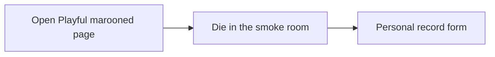

# Smoke for the missing Marooned high score

[PR 6](https://github.com/davidnekovarcz/playful/pull/6) only changes how a stored score is labeled (`2h`, `1d 1h`). It does not create a score, and the Marooned Kaloko walks never die or open Playful, so they stay green while the hub shows nothing.

The name form is not on Marooned’s death screen. It is the Playful overlay “New Personal Record!” in [LeaderboardPopup.tsx](_Playful.Smarlify.co/src/components/LeaderboardPopup.tsx). [GameIframe.tsx](_Playful.Smarlify.co/src/components/GameIframe.tsx) opens it only after a `GAME_OVER` message from the iframe. [postSurvivalScore](Marooned/web/src/hubScore.ts) sends that message only while the game is embedded, and a run that loads already dead does not send it again.

## What the smoke does

1. In Marooned, only for `/?room=kaloko-smoke&kalokoDie=1`, after the character is in the world, set health to 0 with a fixed survival time of 3 island hours. That posts `GAME_OVER` with score `180`. Do not add this to the public demo room.
2. In Playful, add Kaloko the same way Marooned has it (`org: plexima-io`, project `playful`, Chrome, local Next on port 3010). One flow, `qa/flows/smoke-marooned-score.yml`.
3. The hub iframe is hardcoded to Heroku in [games.ts](_Playful.Smarlify.co/src/data/games.ts). For this walk only, on localhost, honor an `embed` query so the iframe loads `http://localhost:5173/?room=kaloko-smoke&kalokoDie=1`.
4. Assert the text “New Personal Record!” is visible. Do not submit the form, so the walk does not write a leaderboard row.

The existing boot, Say, and mobile smokes stay as they are.

## Done means

- The new walk runs against local Vite and local Next.
- It fails on the missing form, which matches what you saw.
- If the form does appear for this embedded death, the walk is green and the gap is elsewhere: a standalone game, or a death that was already saved before the hub opened.
