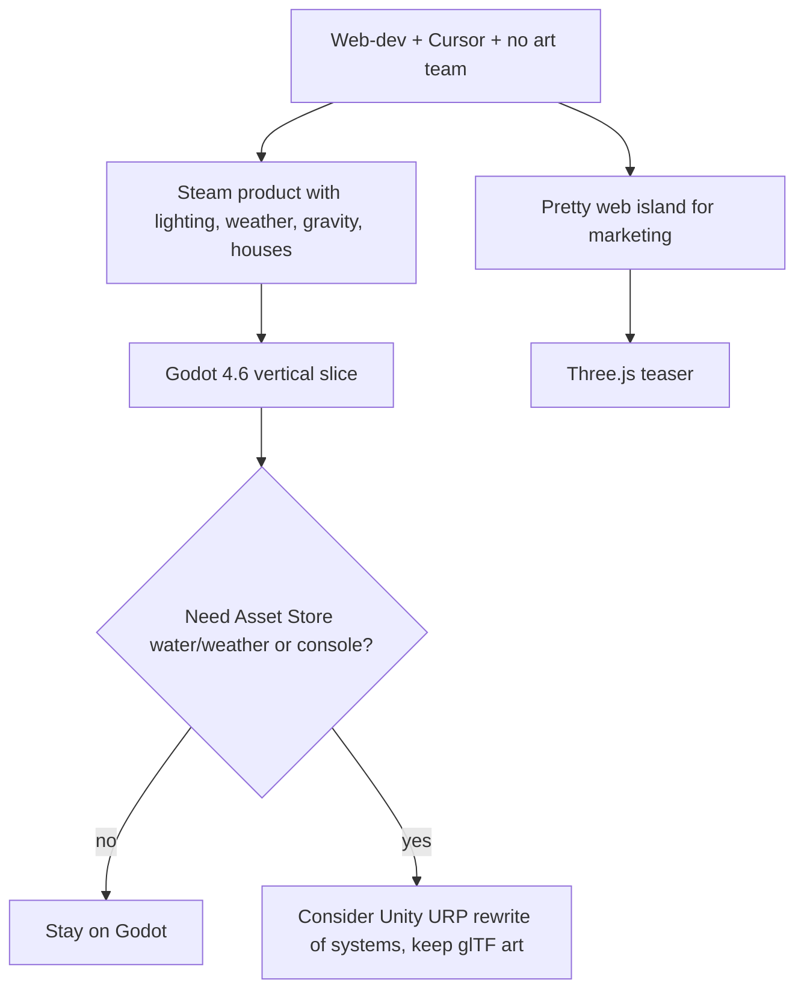

# Marooned — practical stack

Companion to [`GAME.md`](GAME.md). That file is the design pitch. This one answers: *what can we actually build with, given a web-dev background, no art department, and Cursor as the coding partner?*

Evaluated options: **Unity 6 (URP)**, **Godot 4.6+**, **Three.js** (plus a short note on Babylon.js). Unreal is out of scope: too heavy for this team and this art direction.

**Short recommendation:** ship the game in **Godot 4.6**. Use **Three.js only for a web teaser**. Treat **Unity** as the fallback if you later need Asset Store weather/water kits or console/mobile polish that Godot is not giving you.

---

## Scoreboard (this project, not “in general”)

| Question | Winner | Runner-up | Why |
| --- | --- | --- | --- |
| 1. Developable *inside Cursor* | **Three.js**, then **Godot** | Unity (C# only) | Cursor is a code editor. Three.js is 100% code. Godot scenes are text. Unity scenes/terrain live in the Unity Editor. |
| 2. Best UI / map editor | **Unity** | Godot (Terrain3D + GridMap) | Unity Terrain + ProBuilder are the most complete out of the box. Godot is enough for one island. Three.js has no editor. |
| 3. Free, copyright-clear assets | **Tie: Unity / Godot / Three.js** | — | Low-poly is just glTF/FBX. Same Kenney + Quaternius packs import everywhere. Unity Asset Store has *more paid kits*, not better *free CC0*. |
| 4. One pack that has everything | **None** | Kenney Survival + Nature + Pirate | You assemble 5–8 CC0 packs. Links in §4. |
| 5. Lighting, weather, day/night, shadows, gravity | **Unity URP** (ceiling) | **Godot** (best fit for *this* game) | Unity still has the deeper 3D toolbox. Godot SDFGI + Jolt is enough for an *Islanders*-look island and is easier for dynamic day/night. |

---

## 1. Which of these can we develop in Cursor? Can I handle Unity?

Cursor is a **code** editor (VS Code fork + agent). It does not replace a game editor’s Scene view, terrain brushes, or play-mode. What I can do well is write and refactor the files that *are* text.

### 1.1 Honest capability matrix

| Work | Three.js | Godot 4 | Unity 6 |
| --- | --- | --- | --- |
| Scripts I can write/edit in Cursor | Excellent (TS/JS) | Excellent (GDScript ≈ Python; C# also fine) | Excellent (C#) |
| Scenes / levels I can author as files | Excellent (the scene *is* code) | Good (`.tscn` is text; I can generate and patch it) | Weak (`.unity` YAML + GUIDs; easy to corrupt) |
| Terrain / foliage painting | Code or Blender only | You paint in Godot; I can script scatter | You paint in Unity; I cannot sculpt Terrain from here |
| Play, click, look at lighting | Dev server + browser | Godot Editor (your machine) or headless tests | Unity Editor play mode (your machine) |
| Cloud Agent / this environment | Best (Node + browser) | Good if Godot is installed (headless) | Poor (Unity Hub + Editor + license is a GUI product) |
| IntelliSense in Cursor | Native | `godot-tools` extension + Godot LSP | Set Cursor as Unity External Script Editor, regenerate `.csproj`, C# extension |
| Risk of AI writing stale APIs | Medium | Medium (Godot 3 vs 4) | High without a project rule file (Unity 6 APIs changed) |

### 1.2 Can I “handle Unity”?

**Yes for C#. No for being the Unity Editor.**

Proven desktop workflow (2026):

1. Unity Hub → Unity 6 LTS, **URP**.
2. Edit → Preferences → External Tools → External Script Editor = **Cursor**.
3. Regenerate project files so `.sln` / `.csproj` exist.
4. Open the folder that contains `Assets/` in Cursor (not a parent folder, not a single `.cs` file).
5. Put a project rule in the repo: Unity 6, URP, C# conventions, “do not use obsolete `rigidbody.velocity` / old Input Manager,” etc.

I can then write gameplay (needs, loot, crafting, netcode), UI scripts, shaders-as-code, and editor scripts. **You** (or you + me describing steps) still:

- import assets in Unity,
- sculpt terrain,
- place lights and volumes,
- press Play,
- debug with Unity’s frame debugger / physics debugger.

Rider is still better than Cursor for deep Unity debugging. Cursor is better for generating and iterating gameplay code. They can coexist.

**Godot + Cursor** is the closer pairing: GDScript, `.tscn`, `.gdshader`, and `project.godot` are all text. Optional MCP bridges exist that let an agent inspect the scene tree; they need a running Godot on your machine, not in a typical cloud VM.

**Three.js + Cursor** is the pairing I can drive end-to-end: Vite/TS, `GLTFLoader`, Rapier/Cannon gravity, a browser preview.

### 1.3 What this means for Marooned

If the goal is “Cursor writes most of the game, I learn the editor for layout and art,” **Godot wins**. If the goal is “I live in Unity’s Scene view and Cursor is my C# pair programmer,” Unity works, but you will spend more hours in Unity than in Cursor. If the goal is “stay in the browser,” Three.js wins the workflow and loses the Steam product (see [`GAME.md`](GAME.md) §8).

---

## 2. Which framework has the best UI tools (map editor, etc.)?

“UI tools” here means **editor tools for building the island**, not the in-game HUD (all three can do a Don’t Starve–simple HUD).

### 2.1 Map / island authoring

| Tool | Unity | Godot | Three.js |
| --- | --- | --- | --- |
| Heightmap terrain sculpt + paint | **Built-in Terrain** + Terrain Tools package. Best default. | No first-party terrain. **[Terrain3D](https://store.godotengine.org/asset/tokisangames/terrain3d/)** (free, Godot 4.4+) is the standard: sculpt, holes, wetness, foliage, up to tens of km. Enough for one island. | None. Write a heightmap mesh, use a library, or export from Blender. |
| Modular “place pieces” (house, wreck, hut) | ProBuilder, Prefabs, Terrain trees/details | **GridMap** + MeshLibrary, CSG for greybox, MultiMesh scatter | Code, or a third-party web editor (Spline, etc.) then export |
| Greybox before art | ProBuilder | CSG (box/sphere/polygon), then bake to mesh | Boxes in code |
| Water | URP water / Asset Store (many) | Plane + shader, or community water; fewer turnkey kits | `Water` examples / custom shader; you own it |
| Navigation (walkable island) | NavMesh bake | NavigationRegion3D bake | You roll it (or Recast wasm) |

For *Islanders*-style **readable low-poly hills + placed trees**, you do **not** need Unity’s full open-world terrain stack. A small heightmap (Unity Terrain *or* Terrain3D *or* a Blender mesh) plus scattered glTF trees is the whole island.

For **house building as gameplay** (lean-to → hut → house), Godot **GridMap** / placing scenes is a very good fit. Unity Prefabs are equally good. Three.js means you write a placement system from scratch.

### 2.2 Verdict on question 2

- **Best editor product:** Unity.
- **Best editor for *this* island + Cursor:** Godot (text scenes + Terrain3D + GridMap).
- **Worst editor:** Three.js (there isn’t one). Compensate with Blender or Kenney [Asset Forge](https://kenney.nl/tools/asset-forge) (block-based models, export glTF/FBX for any engine). Asset Forge is the closest thing to “I’m not a 3D artist” modeling.

HUD / menus: Unity uGUI / UI Toolkit and Godot Control nodes both beat rolling HTML overlays in a Three.js canvas, once the game is a real product.

---

## 3. Which framework is best for free, copyright-clear graphics and sound?

**The engine does not own the art.** Low-poly trees, boats, and crates are files (`gltf` / `glb` / `fbx` / `wav`). Unity, Godot, and Three.js all import them.

| Source | License | Unity | Godot | Three.js |
| --- | --- | --- | --- | --- |
| Kenney, Quaternius, Poly Haven | **CC0** (public domain; attribution optional) | Yes | Yes | Yes (`GLTFLoader`) |
| Mixamo | Free commercial use; **not CC0**; do not redistribute raw files | Yes (FBX) | Yes (FBX) | Yes after FBX → glTF |
| Unity Asset Store | Store EULA (usually not CC0) | Native | No | No |
| Godot Asset Library | Mixed; many MIT/CC0 | No | Native | No |
| Sketchfab | **Per-file** — check every download | Yes | Yes | Yes |

**Unity’s advantage** is paid/free *complete systems* (inventory, weather, water, survival templates), not free copyright. Many “free” Unity packs are Standard Unity Asset Store License: fine inside a Unity game, **not** something you can later move to Godot/Three.js as freely as CC0.

**Godot’s library** is smaller and more “plugins + shaders” than “full tropical island kits.”

**Three.js** has the same CC0 glTF universe. That is why low-poly looks easy on the web: the models were never Three-specific.

### 3.1 Practical rule for Marooned

Prefer **CC0 glTF**. Then the vertical slice can move between Godot and a Three.js teaser without a lawyer or a rewrite of the art. Avoid betting the look on a Unity-only survival template.

---

## 4. Asset packs (links) — assemble a full island

There is **no single CC0 pack** that contains: tropical island + palms + wrecks + tools + food + characters + rain/wind/surf + UI beeps. Closest “starter crate” is **Kenney Survival Kit + Kenney Nature Kit + Kenney Pirate/Watercraft + Kenney audio + a Quaternius nature/character pack**.

License reminder: Kenney and Quaternius free packs are **CC0** (commercial OK, credit nice not required). Mixamo and Unity Store are different — read the row.

### 4.1 Recommended download list for the MVP (use these first)

**World and loot**

| Pack | What you get for Marooned | Link |
| --- | --- | --- |
| Kenney **Survival Kit** | ~80 low-poly structures, tools, resources — the closest all-in-one | https://kenney.nl/assets/survival-kit |
| Kenney **Nature Kit** | Trees, rocks, foliage | https://kenney.nl/assets/nature-kit |
| Kenney **Mini Forest** | Extra small-scale nature | https://kenney.nl/assets/mini-forest |
| Kenney **Modular Cave Kit** | Cave biome | https://kenney.nl/assets/modular-cave-kit |
| Kenney **Pirate Kit** | Fort / island-adjacent kitsch, wreck-adjacent pieces | https://kenney.nl/assets/pirate-kit |
| Kenney **Watercraft Kit** | Boats for crashed-boat loot spots | https://kenney.nl/assets/watercraft-kit |
| Quaternius **Survival Pack** | 50+ survival props (overlap with Kenney; more variety) | https://quaternius.com/packs/survival.html |
| Quaternius **Ultimate Nature Pack** | 150 nature models | https://quaternius.com/packs/ultimatenature.html |
| Quaternius **Stylized Nature MegaKit** | 110+ Ghibli-adjacent trees/plants/rocks; Source includes Unity/Godot scenes | https://quaternius.com/packs/stylizednaturemegakit.html |
| Quaternius **Pirate Kit** | 71 models, boats + environment, glTF | https://quaternius.com/packs/piratekit.html |
| Quaternius **Fantasy Props MegaKit** | 200+ tools, chests, food-adjacent props, furniture | https://quaternius.com/packs/fantasypropsmegakit.html |

**Food, house, people**

| Pack | What you get | Link |
| --- | --- | --- |
| Kenney **Food Kit** | Pickup food meshes | https://kenney.nl/assets/food-kit |
| Quaternius **Ultimate Food Pack** | 100+ food/consumables | https://quaternius.com/packs/ultimatefood.html |
| Kenney **Furniture Kit** | Interior / hut dressing | https://kenney.nl/assets/furniture-kit |
| Quaternius **Ultimate House Interior Pack** | House identity later | https://quaternius.com/packs.html (House Interior) |
| Kenney **Animated Characters Survivors** | Simple rigged people, on-theme | https://kenney.nl/assets/animated-characters-survivors |
| Kenney **Animated Characters Protagonists** | Extra cast | https://kenney.nl/assets/animated-characters-protagonists |
| Quaternius **Universal Animation Library** | Walk/run/emotes, retarget to Unity/Godot | https://quaternius.com/packs/universalanimationlibrary.html |
| Quaternius **UAL 2** | Farming, fishing, parkour — later | https://quaternius.com/packs/universalanimationlibrary2.html |
| Mixamo | Auto-rig + mocap (commercial OK; not CC0; don’t resell raw files) | https://www.mixamo.com |

**Sky, lighting, audio**

| Pack | What you get | Link |
| --- | --- | --- |
| Kenney **Skyboxes** | Stylized skies (better match than photoreal HDRIs) | https://kenney.nl/assets/skyboxes |
| Poly Haven **HDRIs** | CC0 skies/lighting if you want richer sun (can look too real next to Kenney meshes) | https://polyhaven.com/hdris |
| Poly Haven **textures** | CC0 ground/sand/wood if you leave pure vertex colors | https://polyhaven.com/textures |
| Kenney **RPG Audio** | Hits, pickups, fantasy-adjacent SFX | https://kenney.nl/assets/rpg-audio |
| Kenney **Impact Sounds** | 130 foley hits | https://kenney.nl/assets/impact-sounds |
| Kenney **Interface Sounds** | UI | https://kenney.nl/assets/interface-sounds |
| Kenney **UI Audio** | More UI | https://kenney.nl/assets/ui-audio |
| Kenney **Music Jingles** | Placeholder stingers | https://kenney.nl/assets/music-jingles |
| Kenney **all audio** | Index | https://kenney.nl/assets/category:Audio |
| Freesound **CC0 filter** | Rain, wind, surf — **filter license to CC0**; CC-BY needs credits | https://freesound.org/search/?f=license%3A%22Creative+Commons+0%22 |

**Indexes (browse when a specific mesh is missing)**

| Site | Notes | Link |
| --- | --- | --- |
| Kenney all assets | Entire CC0 catalog | https://kenney.nl/assets |
| Kenney All-in-1 | Paid zip of everything; files remain CC0 | https://kenney.nl/assets |
| Quaternius catalog | Most packs ~60–70% free CC0; Source/Pro add the rest (still CC0) | https://quaternius.com |
| Poly Pizza | Searchable low-poly, many CC0 | https://poly.pizza |
| OpenGameArt | Mixed licenses — check each file | https://opengameart.org |
| Godot Asset Library | Terrain3D, water, scatter | https://godotengine.org/asset-library/asset |
| Terrain3D | Godot map editor stand-in | https://store.godotengine.org/asset/tokisangames/terrain3d/ |
| Unity Asset Store | Search “low poly island” / “tropical”; **EULA ≠ CC0** | https://assetstore.unity.com |
| itch.io (examples) | Extra islands; confirm license | [Gataki island](https://gataki.itch.io/free-low-poly-island-map-game-and-mobile-ready), [SandHero island](https://sandherostudio.itch.io/low-poly-island) |

### 4.2 What this list still does *not* give you

You still make (or shader) **ocean**, **rain**, **wet clothes**, **day/night**, and **storm lighting**. Those are systems, not a missing palm tree. Unity has more buyable weather kits; Godot/Three.js you write a directional light + sky + particles + a wetness parameter (which matches [`GAME.md`](GAME.md) anyway).

### 4.3 Import cheat sheet

- Prefer **glTF/GLB** (Godot and Three.js love it; Unity imports it too).
- Unity: FBX is still the most boring-reliable path; Mixamo “FBX for Unity” exists.
- Godot 4: import glTF, extract materials, turn off accidental metalness on Kenney colors.
- Three.js: `GLTFLoader` + `DRACOLoader` if compressed; Mixamo FBX → Blender/gltf-transform → `.glb`.
- Keep a `THIRD_PARTY_LICENSES.md` even for CC0 (Mixamo + any CC-BY Freesound).

---

## 5. Performance, dynamic lighting, weather, day/night, shadows, gravity

### 5.1 Feature-by-feature (for a small low-poly island, 8–16 players)

| Feature | Unity 6 URP | Godot 4.6 | Three.js |
| --- | --- | --- | --- |
| **Raw 3D performance** | Highest ceiling; mature LOD, occlusion, URP | Close on a *small* island; Vulkan Forward+ is enough | Best *web* perf; wrapping it for Steam (Electron) is a trap |
| **Shadows** | Cascaded directional shadows, well documented | DirectionalLight3D + shadows; good enough | `DirectionalLight` + shadow maps; you tune bias yourself |
| **Dynamic / day-night GI** | URP prefers **baked lightmaps + probes**; real-time GI is extra work or HDRP | **SDFGI** is built for moving sun / open world, no bake — strong fit for storms and night | You fake it (hemisphere light + fog + color grade). Looks great if stylized; not a GI solution |
| **Weather** | Asset Store (Enviro-class) *or* custom | Particles + `WorldEnvironment` fog + light energy; more DIY | Particles + post; all DIY |
| **Volumetric fog / god rays** | URP/HDRP volumes | Built-in volumetric fog (pretty, not free) | Custom / examples |
| **Water** | Many production assets | Shader + mesh; fewer complete kits | Famous demos; you maintain the shader |
| **Gravity / bodies** | PhysX (or Unity Physics); CharacterController | **Jolt** default 3D in 4.6; CharacterBody3D | **Rapier** or Cannon; you wire it |
| **Wetness / puddles** | Shader Graph + terrain wetness maps | Terrain3D has **wetness painting**; shaders for clothes | Custom uniforms on materials |

Unity still wins the **AAA feature list**. Marooned is not AAA: *Islanders* lighting is a strong sun, clean shadows, saturated fog, and a sky that changes. Godot’s **WorldEnvironment + DirectionalLight3D + SDFGI + volumetric fog** is the fastest path to that look without baking lightmaps every time you move a palm.

Three.js can *look* as good as *Islanders* (that look is common on the web). It will not give you gravity, weather, and a 16-player authoritative island “for free.”

### 5.2 Performance note that actually matters

The expensive part of Marooned is not polycount. It is **a dedicated server + persistence** (loot timers, houses, weather) — already in [`GAME.md`](GAME.md) §8.3. All three stacks need that. Native Godot/Unity clients will have an easier time with shadows and 16 characters than a browser tab.

Target: **orbit camera, low-poly, one island**. Any of the three can hold 60 FPS on a laptop if you instance trees (MultiMesh / GPU instancing) and do not enable every fog slider at once.

### 5.3 Verdict on question 5

- **Best toolbox:** Unity URP (HDRP is overkill and fights the art style).
- **Best match for dynamic day/night + storms on a small island, with less lighting homework:** Godot 4.6.
- **Best pretty demo, weakest simulation product:** Three.js.

---

## 6. Language and learning curve (web-dev background)

| | Feels like | Time to first moving 3D character |
| --- | --- | --- |
| **GDScript** | Python + a bit of JS | Hours in Godot, if you accept the node tree |
| **Unity C#** | “Real” app C# + a component model | A day or two of editor + prefab muscle memory |
| **Three.js TS** | Home | Fastest *visual*; slowest *game* (you build the engine around it) |

You do not need to become a graphic designer. Pipeline:

1. Download CC0 packs above.
2. Greybox the island (CSG / ProBuilder / a plane).
3. Drop trees and a wreck.
4. Orbit camera + CharacterBody / CharacterController + four need bars.
5. Then lighting and rain.

Kenney [Asset Forge](https://kenney.nl/tools/asset-forge) covers one-off meshes (a unique house roof) without Blender. Learn Blender later only for Mixamo cleanup and custom wrecks.

---

## 7. Recommendation locked to Marooned

| Role | Pick | Reason |
| --- | --- | --- |
| **Product (Steam, later mobile)** | **Godot 4.6**, Forward+ , Jolt, URP-equivalent look via SDFGI | Cursor can own scripts + scenes; MIT license; enough 3D; same CC0 art as Unity |
| **Editor you will actually use** | Godot + Terrain3D + GridMap | One island, modular houses, wetness paint |
| **Cursor’s job** | GDScript, `.tscn`, HUD, loot tables, weather director, server | Text-native |
| **Your job** | Sculpt island, place wrecks/huts, import glTF, press Play | Irreplaceable editor work |
| **Web teaser** | **Three.js** + the same glTF | Marketing, not the save-game |
| **Switch to Unity if** | You want a paid water/weather pack, official consoles, or you fall in love with Terrain + Asset Store | Art can migrate; gameplay scripts cannot |

Do not start in Three.js “and port later.” That is the rewrite [`GAME.md`](GAME.md) already warned about.

**Vertical slice stack (next physical step):** Godot 4.6 project, Kenney Survival + Nature + Watercraft, one Kenney survivor character, Kenney skybox, RPG/Impact/Interface audio, Terrain3D or a hand-placed island mesh, DirectionalLight day/night, rain particles, Jolt gravity. Same fantasy as GAME.md §9.1: wake → coconut → rain → fire → wreck race → lean-to.

---

## 8. Sources (investigation)

Engine comparisons and rendering: Godot 4.6 notes (Jolt default, SDFGI, volumetric fog), Unity 6 URP vs Godot lighting write-ups, Terrain3D docs. Cursor + Unity as external editor is a documented 2026 workflow; Cursor + Godot via `godot-tools` / LSP likewise. Asset licenses taken from Kenney, Quaternius, Poly Haven, and Adobe Mixamo FAQs. Pack pages linked in §4 were fetched at time of writing (2026-09-01). Always re-check a license on the download page before shipping.
