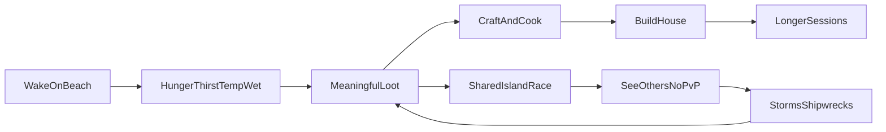

# Marooned — game design

Code-name: **Marooned**  
Working title: Island Survivor  
Document type: pitch (as-is) + design & business response  
Status: pre-prototype — engine not locked

This file has two layers on purpose.

1. **Your brief (as-is)** — the idea in your words, not “improved.”
2. **Design + business response** — playable loops, shared-island rules, how to earn money without pay-to-win, and what to build first.

---

## 1. Pitch (as-is)

This section restates the original brief. It is not a rewrite.

**Marooned** is an Island Survivor game. The goal is to combine an open-world survivor experience (DayZ, PvE) with the graphic inspiration of *Islanders*. A low-poly game should be easier to develop.

Technology is still a choice between **Three.js** and **Unity**. The game must be monetizable: Steam, iOS/Android store, pay-to-win web game, etc.

There should be a **multiplayer feel** — something that attracts more players, streamers, and paying gamers. 3D would be nice; for now a **2.5D** game would be sufficient.

You are marooned on an island: no food, no water, no equipment. Most of the game is about **looting** (as in DayZ): randomly spawned things around the island, preferably in meaningful locations — e.g. a coconut tree spawns a coconut, a crashed boat randomly spawns tools.

There can be **one island for all players**, so they need to come to places to loot them — but they **cannot fight each other**, at least not at the moment.

Use a similar system to DayZ: drink status, food status, temperature status, wet clothes. Later, illnesses from a tropical island and spawning medicine.

The game should allow **crafting** and **building a house**. The house should be demanding in resources and time spent.

Business fork as originally stated:

- either a standard **pay-to-win** scheme to earn money with this game,
- or a **flat fee / monthly subscription** and add educational value — e.g. crafting, learning languages (finding notes with tips in a random language) — so it would be a “good game for kids,” not just dummy scrolling on Facebook or grinding like WoW.

It should be **fun to play**, and it needs to **earn cash**. Business strategy is part of the decision-making.

---

## 2. Fantasy and references

**Positioning:** cute island, serious body.

*Islanders* for silhouettes, lighting, and readable low-poly shapes. DayZ for needs, wetness, scarcity, and “I might not make it through the night.” Do not copy DayZ’s military PvP, guns, or military loot fantasy.

Closest cousins:

| Game | Steal this | Leave this |
| --- | --- | --- |
| *Raft* / *Stranded Deep* | marooned fantasy, ocean, wrecks | endless ocean grind / shark combat as the identity |
| *Don’t Starve* | readable meters, weather as an enemy, “one more day” | grotesque tone if you want kids/families |
| *Valheim* | the house is the endgame, building as prestige | Norse combat loop |
| *Islanders* | art direction, joy of placing a settlement on a hill | city-builder scoring as the core |
| *DayZ* | loot locations that make sense, body simulation | PvP, military, huge map, high-fidelity 3D |

**Why this can be fun:** the tension is *who gets the crate*, not *who shoots whom*. Shared scarcity, visible other camps, and storms are streamer-friendly without combat netcode.

The fantasy in one sentence: you wash up with nothing; the island is pretty; your body is not; other people are racing you to the wreck; your house on the ridge is how you prove you lasted.

---

## 3. Loops and systems

Failure is **gradual** (slow, thirsty, shivering), not instant death. That is better for kids, for “one more run,” and for streamers who need a story instead of a wipe.

### 3.1 Minute-to-minute (body)

Four meters in v1. Illness is later.

| Need | What drains it | What restores it | If it hits empty |
| --- | --- | --- | --- |
| **Thirst** | heat, running, salt food | coconut water, boiled water, rain catcher | slow movement, then pass-out / wake on beach with a penalty (not a full wipe in MVP) |
| **Hunger** | time, labor (chopping, building) | fruit, cooked fish, later meals | same as thirst, slower |
| **Temperature** | night, rain, wind, wet clothes, shade vs sun | fire, shelter, dry clothes, noon sun (can overheat) | shivering (noise, worse crafting), then hypothermia |
| **Wetness** | rain, swimming, surf | fire, sun, shelter, changing clothes | clothes stay wet → temperature tanks; wet inventory can spoil paper notes |

Clothes are not fashion in v1; they are a **wet / dry / warm** layer. A soaked shirt at night is a real problem.

UI: four simple bars or icons in the corner (Don’t Starve readable, not DayZ medical spreadsheet). Color + icon first; numbers optional in a settings pane.

### 3.2 Session loop (one sitting)

1. Check body. Drink or eat if you must.
2. Scavenge one biome (beach, grove, wreck, cave).
3. Craft or repair one tool.
4. Stash at camp / add one piece to the house.
5. If a wreck event or loot respawn is live, **race it**.
6. Get dry and fed before night.

A good session is 20–40 minutes and always leaves a visible mark (a wall, a fire, a crate at camp).

### 3.3 Long loop (the house)

The house is the prestige object. It is expensive on purpose. It should look unique (low-poly kits, not a prefab mansion). Streamers show the house; players screenshot the house; the house is why you log back in.

**Three stages (MVP):**

| Stage | Name | What it takes | What it gives |
| --- | --- | --- | --- |
| 1 | **Lean-to** | sticks, leaves, a few minutes of placing | rain off the bed, tiny stash |
| 2 | **Hut** | planks, fiber rope, stones, a crafted tool, real time standing there building | dry storage, a fire that stays lit longer, a door |
| 3 | **House** | nails/metal from wrecks, lots of wood and stone, multiple sessions | full shelter, crafting bench, identity (color, roof, porch) |

**Later stages (not MVP):** second floor, rain cistern, garden, guest cot (co-op), lighthouse / signal fire as a vanity landmark.

Rules that keep the house “demanding”:

- Pieces are placed in the world, not “buy a house IAP.”
- Some pieces need you to stand and **work** (hold to hammer) so time spent is real.
- Rare parts (hinges, nails, glass, canvas) only come from wrecks and huts — shared-island pressure.
- You can lose the roof in a storm if it was cheap; a real house holds.

### 3.4 Loot tables (meaningful locations)

Spawns are **typed by place**. Randomness is “is it there this hour,” not “a rifle under a palm.”

**Personal “hand loot”** — you pick it; it does not steal from others in a mean way (berries on a bush can be shared or per-player; see island rules).

**World loot** — one crate, one axe; only one player takes it; then a respawn window.

| Location | Typical loot | Rarity / respawn (guideline) |
| --- | --- | --- |
| Coconut palm | coconut, fronds, later husk fiber | common / 15–20 min |
| Berry bush | berries (hand loot) | common / 10–15 min |
| Freshwater pool | drink, later clay | common / always if you have a container |
| Beach / tide line | driftwood, shell, wet cloth, bottle | common / 15 min |
| Crashed boat / wreck | tools, nails, rope, canvas, sometimes a crate | uncommon / 30–45 min |
| Abandoned hut | cloth, notes, rusty pot, needle | uncommon / 30 min |
| Cave | mushrooms, bats (later), shade, maybe ore | uncommon / 20–30 min |
| Ridge / lookout | rare crate, signal parts, view of wrecks | rare / 45–90 min |
| Storm wreck (event) | best tools, metal, “story” crate | rare / event only |

**MVP item count:** about **15 loot types** is enough to feel like a world.

Suggested MVP items:

1. Coconut  
2. Berries  
3. Driftwood  
4. Stick  
5. Stone  
6. Fiber / fronds  
7. Cloth (wet or dry)  
8. Empty bottle  
9. Rope  
10. Nails  
11. Knife or hatchet (world loot)  
12. Pot  
13. Raw fish (from a simple shore mini-activity, not a fishing sim)  
14. Note (paper, can get wet)  
15. Bandage / cloth strip (later illness uses this; in MVP it is just cloth)

### 3.5 Crafting (MVP: 5–8 recipes)

Keep the list short so every recipe is memorable.

| Recipe | Inputs | Why it exists |
| --- | --- | --- |
| **Stone knife** | stone + stick | first tool, opens more recipes |
| **Bandage / cloth strip** | cloth | wetness / later bleeding |
| **Campfire** | wood + stone ring | cook, dry, night |
| **Coconut bowl / bottle fill** | coconut or bottle + water source | thirst |
| **Cooked fish** | fish + fire | hunger that lasts |
| **Fiber rope** | fronds / fiber | hut and tools |
| **Lean-to kit** | sticks + leaves | stage 1 house |
| **Plank** (optional 8th) | wood + knife + time | stage 2 house |

Recipes can show a one-line **real-world hint** (“Boil water if you can; coconuts are safer than standing water”). That is education without a quiz. Survival still works if you ignore the hint.

### 3.6 Weather and time

- Day / night. Night is colder; fire and house matter.
- Rain: wet clothes, refill catchers, wrecks more likely after a storm.
- Storm event: trees drop extra wood; a **shipwreck crate** can wash in. This is the streamer set-piece.

No tropical illness in MVP. When it comes: mosquitoes after rain, bad water, infected cuts; medicine spawns in huts and wrecks — same loot logic as tools.

---

## 4. Shared island rules (multiplayer, no fighting)

**v1 target:** one persistent island, about **8–16 players** in the MVP, designed so it can grow to **~20–40 concurrent** later. Not a DayZ 60+ shard.

Players share the island. They contest loot. They **cannot damage each other**.

### 4.1 Soft contest (the PvP without PvP)

- You can **see** someone running to the wreck. You cannot kill them.
- World loot is first-come, first-served.
- Camps, smoke, and a house on a ridge are visible. That is social pressure and streamer content.
- Optional help: drop items on the ground, emotes, a **“share water”** action (hold use on a player with a bottle).

This is the multiplayer feel: other humans are weather with faces. Streamers narrate the race, not the killcam.

### 4.2 Anti-empty-island (so late players are not starved)

If everything is global and rare, the first four players eat the island and everyone else quits.

Split loot into two buckets:

| Bucket | Examples | Rule |
| --- | --- | --- |
| **Hand loot** | berries, fallen coconuts, driftwood on the open beach | either per-player or high-frequency respawn so the island always “gives a little” |
| **World loot** | axe, crate, pot, nails | one taker; **respawn window** 15–45 min (longer for rare tools) |

Guidelines:

- Food and water should never be fully gated by other players.
- Tools and house-rare parts **are** gated — that is the race.
- After a storm, extra world loot spawns so the whole server gets a story, not just whoever was online at 3 a.m.

### 4.3 Persistence

The server owns:

- player positions (while online)
- world loot state and timers
- placed house pieces and campfires
- weather / wreck events

Players who log off leave a **camp and house** in the world. That is the “I live here” feel. Footprints / smoke can fade so the island does not become visual noise.

### 4.4 Social without combat (v1 vs later)

**v1**

- presence (bodies, names optional, smoke, houses)
- drops and share-water
- emotes
- no reputation, no clans, no PvP

**Later (not v1)**

- reputation (“helped me” / “looted my porch” — porch looting is a design choice; default: outdoor world loot is fair game, **indoor house stash is private**)
- co-op house / guest cot
- tropical illness and medicine
- a **separate** PvP or “hardcore” shard if you ever want it — do not mix it into the default kid-safe island

Default stash rule (recommended): **what is inside a closed house is yours.** What is in the open world is contested. That keeps the house worth building without needing combat to defend it.

### 4.5 Streamer bait (no toxicity from killing newbies)

- rare wrecks and storm timing
- weather that changes the whole island’s look
- house tours (low-poly dioramas on a ridge)
- loot races (“we both saw the crate”)
- optional language notes as a running gag / teachable moment

---

## 5. Presentation: 2.5D vs 3D, art

**Recommendation:** isometric or orbit camera, **true 3D world**, low-poly meshes (*Islanders*). That is 2.5D presentation, 3D gameplay.

Same assets if you later add a free / third-person camera. A full DayZ-style camera is a **later stretch**, not MVP.

| Choice | Meaning for Marooned |
| --- | --- |
| **2.5D presentation** | orbit or iso camera, readable silhouettes, Islanders lighting |
| **3D world** | height, roofs you can walk around, wrecks in the surf, real placement of house pieces |
| **Full 3D avatar camera** | later; more animation, more hiding, more production |

Art direction:

- low-poly, high contrast, sun and water that look expensive even if meshes are cheap
- characters as simple as *Islanders* villagers — readable at a distance on a shared island
- UI large and friendly (kids + stream overlay)

Audio: wind, surf, rain, distant hammering from another player’s house. Quiet most of the time; storms are loud.

---

## 6. Education (without becoming homework)

Keep the kid-safe / school-friendly angle. **Do not gate survival behind lessons.**

- Notes in other languages = optional flavor + a glossary. Survival still works in the player’s UI language.
- Notes can get **wet and blur** — a systems joke that also teaches “keep paper dry.”
- Crafting recipes mention real-world logic (boil water, dry clothes, shade vs sun).
- “Academy” pack (subscription or DLC) for extra languages, quizzes, classroom mode — **content / cosmetics**, never better loot.

This keeps Steam and streamer credibility and still supports a family pitch.

If a parent asks “why is this better than scrolling”: because the child is managing thirst, weather, and a house they built, and they *can* pick up a Spanish or Czech note without being forced through a textbook.

---

## 7. Monetization (hybrid — not pay-to-win)

Investor / agency one-pager (costs, store sequence): [`LEAN_CANVAS.md`](LEAN_CANVAS.md).

**Do not ship pay-to-win.** It fights the kids/education story, Steam reviews, and streamers. Selling hunger-skips, better loot, or a finished house would also kill the game described in the pitch.

The original fork (P2W vs subscription-for-kids) is resolved as a **hybrid of premium + free demo + optional Academy**, not as P2W.

### 7.1 Why P2W is the wrong cash machine here

- Steam survival audiences review-bomb P2W.
- Streamers mock “buy the coconut.”
- A “good game for kids” cannot sell advantage.
- Your core loop *is* scarcity. Selling scarcity-skip is selling the hole in the game.

Convenience IAPs that skip hunger or building are P2W by another name. Skip them.

### 7.2 Product stack (how money actually comes in)

| SKU | Role | What the player gets |
| --- | --- | --- |
| **Steam (primary cash)** | one-time buy, indie survival pricing **$12–20** | full island, house, storms, notes |
| **Steam demo** | conversion | tutorial beach / limited time of day / no full house |
| **Web** | acquisition, not the economy | free limited island / tutorial beach; same engine export if possible |
| **iOS / Android (later)** | premium **or** “unlock full game” IAP | then **cosmetics only** (skins, house ornaments, pets that do not farm) |
| **Marooned Academy** | optional subscription or DLC | extra languages, classroom, quizzes, extra notes — clearly separate, no better axe |
| **Live ops / extras** | ongoing cash without P2W | seasonal wreck *cosmetics*, supporter pack, soundtrack, “island postcard” DLC |

### 7.3 What you may sell vs what you must not

**Sell:** looks (character, roof color, ornaments), extra language packs, soundtrack, supporter badge, Academy.

**Do not sell:** food, water, tools, nails, house stages, faster hunger regen, private “VIP loot islands,” pay-to-skip storms.

### 7.4 Who pays, and why this can work

- **Steam buyers** — the main revenue. Survival + building + shared-island stories.
- **Parents** — one purchase, no gacha, optional Academy if they want languages.
- **Streamers** — they need a game they are not embarrassed to overlay a sub goal on. Cosmetics and houses, not crates with power.
- **Schools** — only if Academy stays a **separate** SKU so the base game does not feel like edutainment.

### 7.5 Rough order of business risk

1. Ship a **fun 20-minute loop** (needs + loot + tiny shelter) as a demo. If this is not fun, no store saves it.
2. Prove **shared-island** with a handful of players (loot races, not empty island).
3. Steam page + demo. Web teaser if the engine exports cheaply.
4. Cosmetics and Academy **after** the core is loved.
5. Mobile last — stores and certification are a second product.

---

## 8. Tech comparison (not locked)

Practical follow-up (Cursor, map editors, CC0 asset links, lighting/weather): **[`STACK.md`](STACK.md)**.

The renderer is not the expensive part. **A dedicated server plus persistence** (positions, loot state, house blueprints) is the real cost, on any engine.

### 8.1 Comparison

| | **Unity** | **Godot 4** | **Three.js (web)** |
| --- | --- | --- | --- |
| **Steam** | Excellent (official tools, huge install base) | Excellent (export + Steamworks via plugins / GDExtension) | Weak as the *product*; you’d wrap Electron/Steam and still look like a browser game |
| **iOS / Android** | Excellent, well-trodden | Good; more DIY for store polish, IAP, performance | Possible via wrappers (Capacitor, etc.); not a great 3D mobile path |
| **Web** | WebGL export works; heavy download | Web export improving; still a constraint | **Best** — this is its home |
| **2.5D / 3D low-poly** | Strong | Strong | Strong for a pretty island; weaker for big tools (animation, builds, consoles) |
| **Multiplayer** | Many net libs; you still write gameplay + server | Same: you still write a server | Same; plus you’ll want a backend anyway |
| **License / cost** | Install-free; revenue share only at high scale (check current Unity terms) | Zero engine fee | Zero engine fee |
| **Solo / small team speed** | Fast if you already know C#; Asset Store | Fast, GDScript is quick; fewer “survival kits” than Unity | Fastest *pretty web demo*; slowest path to a full Steam survival game |
| **Rewrite risk** | Low if this is the product | Low if this is the product | **High** if Steam + mobile become the real game |

### 8.2 Recommendation (not a mandate)

- **Prototype / vertical slice:** **Godot 4 or Unity** — a real 3D low-poly island, needs HUD, two loot tables, one house piece. Not Three.js unless the *only* goal is a viral web demo.
- **Three.js:** best for a **marketing web teaser**. Weak as the long-term Steam + iOS + Android product without a rewrite.
- **Unity:** strongest store + Asset Store path if you already know C# and want mobile later.
- **Godot:** zero license fee, good 2.5D/3D, Steam + mobile + web; slightly more DIY for polish and mobile stores.

Pick the engine **after** a vertical slice checklist (below), not before. This document does not lock the stack.

### 8.3 What any stack must budget for

- dedicated game server (even for 8–16 players)
- persistence (houses cannot vanish on restart)
- anti-cheat is mild without PvP, but loot and house placement still need to be **server-authoritative**
- accounts later (Steam ID); MVP can be a shared server with simple names

---

## 9. Roadmap: MVP vs commercial v1 vs later

Execution checklist (done vs remaining): [`../TODOs.md`](../TODOs.md).

### 9.1 MVP (fun + demo-able)

Goal: prove the fantasy in a week-of-playtest sense, not a store launch.

- one island biome (beach + grove + one wreck + one hut)
- hunger / thirst / wet / temp
- ~15 loot types, hand loot vs world loot, respawn windows
- 5–8 crafts
- house stages 1–3, even if stage 3 is rare
- **8–16 players**, no combat, no illness, **no shop**
- orbit / iso camera, low-poly
- storms optional but high value if cheap to add

**Vertical slice (before calling it an MVP):** wake on beach → drink a coconut → get rained on → dry at a fire → lose a race to a wreck crate **or** win it → place a lean-to. If that isn’t fun, stop and redesign; do not add languages or IAP.

### 9.2 v1 commercial (Steam)

- full loop + house as long goal
- storms and wreck events
- notes (including other languages as flavor)
- cosmetics that do not affect survival
- Steam demo + paid game
- web limited island **if** export cost is low

### 9.3 Later

- tropical illness and medicine
- more biomes / bigger island or more islands
- Marooned Academy SKU
- iOS / Android
- reputation, co-op house
- optional PvP **server**, never the default family island

---

## 10. Open questions

These are not blockers for this design; they are the next decisions when a prototype exists.

1. **Engine:** Unity vs Godot for the vertical slice? (Three.js only if the first artifact is a web trailer-island.) See [`STACK.md`](STACK.md) for a practical recommendation (Godot 4.6 + Three.js teaser).
2. **Indoor stash:** confirm “closed house is private, open world is contested.”
3. **Death:** pass-out and wake on the beach with a penalty vs permadeath vs “ghost walk back to corpse.” MVP should not be permadeath.
4. **Population:** one global island vs several shards (EU/US, or overflow when >40).
5. **Voice / tone:** slightly serious *Stranded Deep* vs warmer *Islanders* narrator. Kids pitch wants warmer; streamers often want a bit of danger in the writing.
6. **Language set for notes:** which languages in the base game vs Academy?
7. **Name:** keep code-name Marooned for Steam, or a public title that is easier to search?

---

## 11. One-page summary

**Marooned** is a low-poly island survival game: DayZ body and loot logic, *Islanders* look, shared world, **no PvP** at launch. You start with nothing. You loot places that make sense. You race other players to wrecks. You spend real time and rare parts on a house. Education is flavor and an optional Academy pack, not a gate. Money comes from a **Steam buy**, a **free web/demo tease**, later **mobile premium**, and **cosmetics / Academy** — not pay-to-win.

Next physical step: follow [`MVP.md`](MVP.md) (walkable Three.js island first). Godot remains the likely Steam product later — see [`STACK.md`](STACK.md). Docs stay on `main`; assets then game each land via their own feature branch.
