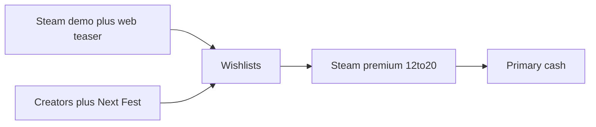

# Marooned — Lean Canvas

**Product:** Marooned (working title: Island Survivor)  
**Stage:** Playable Three.js prototype; not a store build  
**Date:** 2026-09-03  
**Audience:** investors (marketing capital) and marketing agencies (discoverability)  
**Posture:** Steam-first premium. One purchase, no pay-to-win.

Design: [`GAME.md`](GAME.md). Competitors: [`COMPETITORS.md`](COMPETITORS.md). Execution list: [`../TODOs.md`](../TODOs.md). Stack: [`STACK.md`](STACK.md).

Numbers below are **ranges and assumptions**, not promises. Raft proves the *fantasy* can sell at scale; it is not our forecast.

---

## Lean Canvas

| | | |
| --- | --- | --- |
| **Problem** | **Solution** | **Unique value proposition** |
| Cute island, serious body: hunger, thirst, wet, cold — and someone else might reach the wreck first. Military DayZ clones and pay-to-win survival waste that tension. Parents and streamers need a race they can show, not a killcam. | Persistent low-poly island. Location loot, four body meters, house as prestige, 8–16 players who contest crates but cannot fight. Prototype already walks, eats, swims ([`TODOs.md`](../TODOs.md)). Likely Steam product: Godot 4.6, same glTF ([`STACK.md`](STACK.md)). | *Islanders* silhouettes + DayZ body/loot logic + shared island, **no PvP**. One screenshot: island, survivor, camp, wreck, other people. Trailer in 30s: wake → survive → race → build. |
| **Customer segments** | **Channels** | **Unfair advantage** |
| Beachhead: Steam PC survival / cozy-survival buyers (16+). Then: streamers who need a readable loot race; parents who want one purchase and no gacha. Later (separate SKU): schools via Academy. Not v1: mobile whales. | Steam page + demo + Next Fest. YouTube / Twitch (Raft-shaped trailer). Web teaser (Three.js) for acquisition, not the economy. Agency job: capsules, 30s trailer, creator kit — not performance UA on mobile first. | Working island + CC0 Kenney/Quaternius already in repo. Fast iteration (solo + Cursor). Clear no-PvP / no-P2W vs Project Castaway / Raft. This is positioning and a prototype, not a secret algorithm. |
| **Key metrics** | **Revenue streams** | **Cost structure** |
| Wishlists. Demo → purchase %. D1 / D7 return. Concurrent on the shared island. Trailer CTR. Steam review score. | Primary: **$12–20** Steam buy (~30% platform). Demo conversion. Later: cosmetics, soundtrack, Academy — never hunger-skips. | Dev cash is small (solo + Cursor). Real cash: **marketing**, key art/trailer, servers, legal, Steam fee, optional contractor. See §2. |

---

## How money moves

**Assumptions:** list price **$15**; Steam take **~30%**; net ≈ **$10.50** per copy. Marketing is the variable. Development time is the founder’s, not a 10-person payroll.

### Costs to a credible Steam launch (cash, 12–18 months)

| Line | Low | High | Notes |
| --- | --- | --- | --- |
| Marketing / agency / creators | $15k | $80k | Minimum viable vs a real campaign |
| Key art, trailer, capsules | $3k | $20k | Agency or contractor |
| Servers (8–16 players, year 1) | $1k | $8k | Persistence is the product cost |
| Legal (EULA, privacy, age rating) | $1k | $5k | PEGI / ESRB |
| Steam fee + misc | ~$0.5k | ~$0.5k | Direct fee $100 |
| Dev cash (audio, one contractor) | $0 | $15k | Time is the real cost |
| **Total** | **~$25k** | **~$120k** | Most of it marketing |

### Revenue scenarios (lifetime Steam, estimates)

Competitor bands from [`COMPETITORS.md`](COMPETITORS.md). External sales figures there are third-party estimates.

| Scenario | Copies | Gross @ $15 | Net after Steam ~30% | What it rhymes with |
| --- | --- | --- | --- | --- |
| Conservative | 5k–20k | ~$75k–300k | ~$50k–210k | Niche indie (Among Trees-class) |
| Base | 40k–80k | ~$0.6–1.2M | ~$0.4–0.8M | If loop + trailer land (Smalland-ish) |
| Upside | 150k–250k | ~$2–4M | ~$1.6–2.8M | Strong stylized survival — **not** Raft |
| Break-even vs $40k spend | ~4k paid copies | — | — | At $15 / ~$10.50 net |

Raft (~15.8M copies in third-party estimates) is proof the *marooned + build* fantasy can be huge. It is **not** the plan.

Mobile / iOS is a second product. Do not put it in a v1 raise.

---

## Stores (sequence)

1. **Steam** — only store that matters for v1 cash and reviews.
2. **Steam demo + Next Fest** — conversion engine.
3. **Web teaser** — acquisition, not the economy ([`GAME.md`](GAME.md) §7.2).
4. Epic / itch — optional, after Steam is live.
5. **iOS / Android last** — certification and a second store presence.

---

## The ask

**Investor.** Typical check **$40–100k** for **marketing + trailer + ~6 months of servers and legal**, not a 10-person gameplay team. Milestone: Steam page + demo + vertical slice (rain → fire → wreck race → lean-to). If that loop is not fun, stop; more budget will not fix it.

**Marketing agency.** Partner on **discoverability** (wishlists, creators, Next Fest). Gameplay stays in-house. Deliverables: 30-second trailer, store capsules, creator kit.
