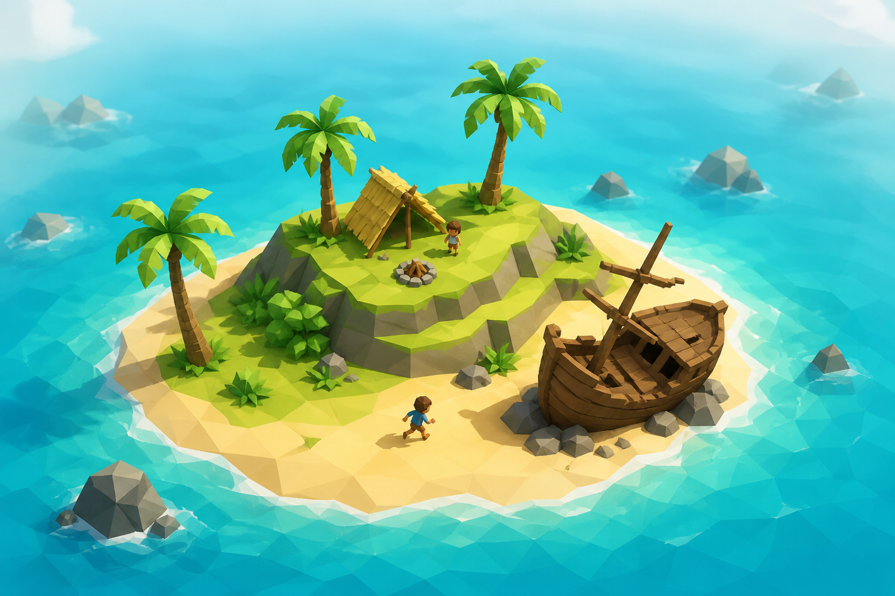
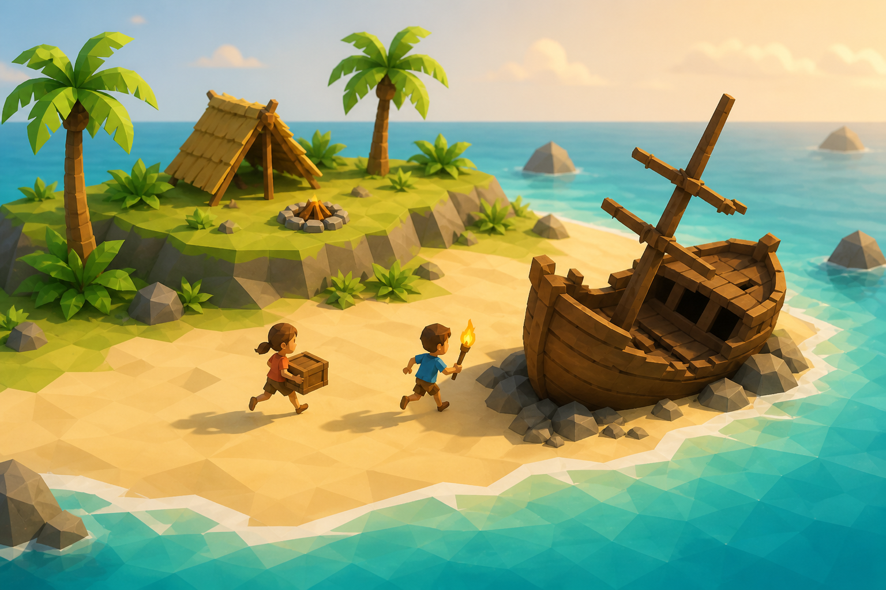
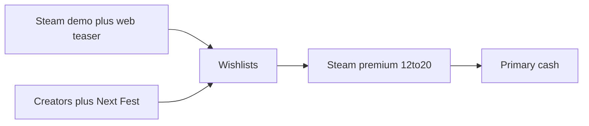

# Marooned — investor one-pager

**Product:** Marooned (working title: Island Survivor)  
**Stage:** Playable Three.js prototype; not a store build  
**Date:** 2026-09-03  
**Ask:** **$15–25k** first, then **$40–100k** total — marketing, not a studio  
**Posture:** Steam-first premium **$12–20**. One purchase. No pay-to-win. No in-game token.

Design: [`GAME.md`](GAME.md). Competitors: [`COMPETITORS.md`](COMPETITORS.md). Execution: [`../TODOs.md`](../TODOs.md). Stack: [`STACK.md`](STACK.md). Short lean-canvas draft: [`LEAN_CANVAS.md`](LEAN_CANVAS.md).

---

## The honest pitch

Steam is a **power-law catalog**. The *average* game looks fine because hits pull the mean up. The **typical** game earns almost nothing.

This raise is **not** “we will be Raft.” Raft (~15.8M copies / ~$228M gross in third-party estimates) only proves the *marooned + build* fantasy can be huge.

This raise is: **a cheap, staged bet on leaving the median** — with a working island, a readable no-PvP loop, and a kill switch before the big marketing spend.

| What is true | What that means for this check |
| --- | --- |
| Most Steam games make **~$0–a few thousand** lifetime | Default outcome if we dump a build with no page, demo, or creators. We do not plan to do that. |
| Mean revenue is **hundreds of thousands** because of hits | Do not quote the mean. It is not the median. |
| Games that actually *ship commercially* (page + reviews) sit in a **different band** | The raise exists to buy that band, not to buy a studio. |
| Sandbox / survival is among the **least-bad** Steam genres for a $100k+ outcome | Category is crowded, but it is also where hits happen. |

---

## Steam, as it actually pays (2025–2026)

Third-party estimates. Not Valve numbers. Not a forecast for Marooned.

### The catalog (almost nobody wins)

| Fact | Figure | Source |
| --- | --- | --- |
| Median lifetime gross, **all Steam games ever** | **&lt; $3,558** | We Love It / [Game World Observer](https://gameworldobserver.com/2026/09/01/the-median-revenue-of-games-on-steam-has-been-declining-for-12-consecutive-years) (Sep 2026) |
| Median for **2026 releases** (so far) | **~$1,728** | Same (down from ~$15k for 2016 releases) |
| Median for **2025 new releases** | **~$249** | Gamalytic via [game-developers.org](https://game-developers.org/steam-paradox-2025-revenue-volume) |
| Share of 2025 releases under **$1,000** | **~66%** | Same |
| Share of catalog under **$10,000** | **~61%** | We Love It / GWO |
| Share of catalog over **$100,000** | **~14%** | We Love It / GWO |
| Top **1%** of games | **~85%** of Steam revenue | We Love It / GWO (84.6%) |
| Mean vs median (2025 releases) | mean **~$359k** vs median **~$249** | Gamalytic — this is why “average Steam game” is a trap |

Half of paid Steam games also sit under ~$3.6k lifetime in GameDiscoverCo-style cuts of the same power law. **Most will end with almost no revenue.** That is the base rate.

### The band this raise is actually buying

Filtering out asset flips and silent dumps changes the picture. That is the point of spend.

| If the game… | Typical lifetime gross (estimates) | Why it is a different animal |
| --- | --- | --- |
| Ships into the catalog with no marketing | **$250 – $5k** | The median. After Steam’s ~30%, this is a hobby. |
| Looks like a real product (commercial intent) | **$5k – $15k** | [Steam Page Analyzer](https://www.steampageanalyzer.com/blog/how-much-do-indie-game-developers-make) canonical indie band |
| Reaches **~100+ Steam reviews** | **$75k – $300k** | Same + Video Game Insights / Zukowski-style review proxies |
| Trailer + Next Fest actually work | **$0.6M – $1.2M** | Smalland-class, still not a hit of record |
| Stylized survival becomes a real hit | **$2M – $4M** | Rare. **Not** the plan. **Not** Raft. |

**Investor translation:** we are not asking you to underwrite the $249 median. We are asking for enough marketing to *attempt* the 100-review band, with a stop if the demo does not convert.

Sandbox is one of the better Steam genres for clearing $100k (~**27%** of sandbox titles vs ~**14%** of the whole catalog — We Love It / GWO). Survival is crowded. It is also the genre where Raft, Grounded, and Stranded Deep already trained the audience.

---

## Why a small check can still be a good check

Downside is **capped**. Upside is a call option on a fantasy that has already printed (Raft). Development cash is not the bottleneck; **discoverability** is.

1. **Asymmetric.** First tranche is **$15–25k**. Full ask is **$40–100k**. Raft-class outcomes are lottery tickets; **returning the check is not.** At $15 list / ~$10.50 net, **~3,800 copies** returns a $40k cheque. That is a quiet Steam week for a visible survival game, not a phenomenon.
2. **Staged, with a kill switch.** Money follows evidence: Steam page → demo → Next Fest / creators. If wishlists and demo conversion miss the gate, **stop**. More budget will not fix an unfun loop.
3. **Capital-efficient.** Solo + Cursor. Prototype already walks, eats, swims. Cash is **key art, trailer, creators, servers, legal** — not a 10-person payroll.
4. **Readable wedge.** Islanders silhouettes + DayZ body/loot + shared island, **no PvP, no P2W**. Streamers and parents can show it. Competitors below are the *fantasy*; they are not the forecast.

The market we are walking into (Steam headers, not our art):

| Raft — proof the fantasy scales | Stranded Deep — tropical survival | Project Castaway — closest peer | Grounded — stylized survival can be huge |
| --- | --- | --- | --- |
|  |  |  |  |

---

## Lean Canvas

| | | |
| --- | --- | --- |
| **Problem** | **Solution** | **Unique value proposition** |
| Cute island, serious body: hunger, thirst, wet, cold — and someone else might reach the wreck first. Military DayZ clones and pay-to-win survival waste that tension. Parents and streamers need a race they can show, not a killcam. | Persistent low-poly island. Location loot, four body meters, house as prestige, 8–16 players who contest crates but cannot fight. Prototype already walks, eats, swims ([`TODOs.md`](../TODOs.md)). Likely Steam product: Godot 4.6, same glTF ([`STACK.md`](STACK.md)). | *Islanders* silhouettes + DayZ body/loot logic + shared island, **no PvP**. One screenshot: island, survivor, camp, wreck, other people. Trailer in 30s: wake → survive → race → build. |
| **Customer segments** | **Channels** | **Unfair advantage** |
| Beachhead: Steam PC survival / cozy-survival buyers (16+). Then: streamers who need a readable loot race; parents who want one purchase and no gacha. Later (separate SKU): schools via Academy. Not v1: mobile whales. | Steam page + demo + Next Fest. YouTube / Twitch (Raft-shaped trailer). Web teaser (Three.js) for acquisition, not the economy. Agency job: capsules, 30s trailer, creator kit — not performance UA on mobile first. | Working island + CC0 Kenney/Quaternius already in repo. Fast iteration (solo + Cursor). Clear no-PvP / no-P2W vs Project Castaway / Raft. This is positioning and a prototype, not a secret algorithm. |
| **Key metrics** | **Revenue streams** | **Cost structure** |
| Wishlists. Demo → purchase %. D1 / D7 return. Concurrent on the shared island. Trailer CTR. Steam review score. **Kill the raise if demo conversion is dead.** | Primary: **$12–20** Steam buy (~30% platform). Demo conversion. Later: cosmetics, soundtrack, Academy — never hunger-skips. | Dev cash is small (solo + Cursor). Real cash: **marketing**, key art/trailer, servers, legal, Steam fee, optional contractor. See below. |

---

## How money moves

**Assumptions:** list price **$15**; Steam take **~30%**; net ≈ **$10.50** per copy. Refunds and VAT sit on top of that. Marketing is the variable. Development time is the founder’s, not a 10-person payroll.

### Costs to a credible Steam launch (cash, 12–18 months)

| Line | Low | High | Notes |
| --- | --- | --- | --- |
| Marketing / agency / creators | $15k | $80k | Minimum viable vs a real campaign |
| Key art, trailer, capsules | $3k | $20k | Agency or contractor |
| Servers (8–16 players, year 1) | $1k | $8k | Persistence is the product cost |
| Legal (EULA, privacy, age rating) | $1k | $5k | PEGI / ESRB |
| Steam fee + misc | ~$0.5k | ~$0.5k | Direct fee $100 |
| Dev cash (audio, one contractor) | $0 | $15k | Time is the real cost |
| **Total** | **~$25k** | **~$120k** | Most of it marketing |

**Tranche 1 ($15–25k):** Steam page, capsules, 30s trailer, demo, Next Fest submission, legal minimum.  
**Tranche 2 (up to $40–100k total):** creators + extra art **only if** wishlists / demo conversion clear the gate.

### Copies needed to return the cash (at $15 / ~$10.50 net)

| Spend | Copies to repay the cheque | Versus the catalog |
| --- | --- | --- |
| $15k (tranche 1) | **~1,400** | Still a small game. Missable. |
| $40k (typical full ask) | **~3,800** | Quiet but *real* Steam presence |
| $100k (high ask) | **~9,500** | Needs the 100-review band to work |
| Median 2025 release (~$249 gross) | — | **Does not return any of this.** That is why we do not ship like the median. |

### Revenue scenarios (lifetime Steam) — use these, not Raft

| Scenario | How to read it | Copies | Gross @ $15 | Net after Steam ~30% |
| --- | --- | --- | --- | --- |
| **Median dump** | Unmarketed catalog default. We treat this as **failure of the plan**, not the plan. | — | **~$0–5k** | ~$0 |
| **Conservative (target)** | Page + demo + 100+ reviews. This is what the raise is for. | 5k–20k | **~$75–300k** | ~$50–210k |
| **Base** | Loop + trailer land (Smalland-ish) | 40k–80k | **~$0.6–1.2M** | ~$0.4–0.8M |
| **Upside** | Strong stylized survival — **not** Raft | 150k–250k | **~$2–4M** | ~$1.6–2.8M |

Among Trees-class niche is the conservative rhyme; Smalland-class is the base rhyme. Raft is **proof of fantasy**, not a line in the model. Mobile / iOS is a second product. Do not put it in a v1 raise.

---

## Stores (sequence)

1. **Steam** — only store that matters for v1 cash and reviews.
2. **Steam demo + Next Fest** — conversion engine and the kill gate.
3. **Web teaser** — acquisition, not the economy ([`GAME.md`](GAME.md) §7.2).
4. Epic / itch — optional, after Steam is live.
5. **iOS / Android last** — certification and a second store presence.

---

## The ask

**Investor.** Write **$15–25k** now for page + demo + trailer. Reserve **$40–100k** total for **marketing + servers + legal**, not a gameplay team.

Milestone for tranche 2: Steam page live, demo converting, vertical slice (rain → fire → wreck race → lean-to) that people finish. If that loop is not fun, **stop**.

**What you are buying:** a call option on a proven island-survival fantasy, priced like a marketing experiment, with a prototype already in-repo and a hard stop if Steam does not care.

**What you are not buying:** a 10-person studio, a Raft clone forecast, or a mobile gacha.

**Marketing agency.** Partner on **discoverability** (wishlists, creators, Next Fest). Gameplay stays in-house. Deliverables: 30-second trailer, store capsules, creator kit.

---

## Sources (revenue)

- We Love It study, reported by [Game World Observer, 2026-09-01](https://gameworldobserver.com/2026/09/01/the-median-revenue-of-games-on-steam-has-been-declining-for-12-consecutive-years) — catalog median, concentration, 2026-release median, sandbox $100k hit rate.
- Gamalytic 2025 release medians, reported by [The Steam Paradox 2025](https://game-developers.org/steam-paradox-2025-revenue-volume) — $249 median, ~66% under $1k, mean vs median.
- [How much do indie developers make (2026)](https://www.steampageanalyzer.com/blog/how-much-do-indie-game-developers-make) — commercial-intent band and 100-review proxy.
- Competitor copy estimates: [`COMPETITORS.md`](COMPETITORS.md) (third-party, not audited).
