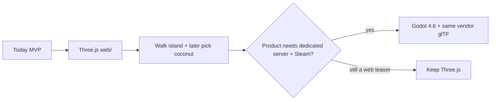

# Marooned MVP — agent playbook

This file is **instructions for the coding agent** (and a checklist for a human). It is not the design bible — that is [`GAME.md`](GAME.md). Stack rationale: [`STACK.md`](STACK.md). Remaining work: [`../TODOs.md`](../TODOs.md). Investor one-pager: [`LEAN_CANVAS2.md`](LEAN_CANVAS2.md). Short canvas: [`LEAN_CANVAS.md`](LEAN_CANVAS.md).

**Steps A+B are done** (walkable island + coconut; HUD and inventory have since landed). Do not re-run this as current work.

**Do this slice before HUD, inventory, crafting, multiplayer, or Godot.** (HUD/inventory: done. Lean-to + cooked fish exist. 4-player Firebase teaser is live. Godot: not yet.)

### Git (how we land work)

| What | Where |
| --- | --- |
| Docs (`*.md`) | Commit on **`main`** |
| Vendor assets (`assets/vendor/`, fetch scripts) | Feature branch → merge to `main` **before** game code. (First dump already landed on `main`.) |
| Game / engine (`web/`, later Godot) | **Feature branch + PR.** Do not develop the playable slice on `main`. |

Order: **assets branch → merge → game branch.** Do not mix a new asset dump and `web/` in the same PR.

---

## 0. Engine for *this* MVP: Three.js (not Godot)

**Use Three.js + Vite + TypeScript, in `web/`.** Do not start a Godot or Unity project in this slice.

Why, given we already said Godot is the likely *product* engine:

1. **This environment can run it today.** Node is here; Godot is not installed; Unity Editor will not run. The agent can `npm run dev`, open the browser, and prove walking.
2. The owner’s background is **web development**. Grid walking + glTF is a Vite app, not an editor workflow.
3. **The art is already engine-agnostic.** Packs live in `assets/vendor/` as glTF/FBX. Godot can import the same files later. We are not painting Unity Terrain.
4. Scope is **tiny**: a rounded island, grid steps, a few props. That is a weekend Three.js scene, not a reason to install Godot yet.
5. Godot **can** export to the browser, but official web builds use the Compatibility renderer (no SDFGI). A Three.js island will look closer to *Islanders* in a tab, with a smaller download.

**What this does *not* mean:** Three.js is not locked as the Steam product. When the walkable island is boring-in-a-good-way and we add persistence / 8–16 players, revisit Godot per STACK.md. Do not rewrite until that moment.



---

## 1. What “done” means (two steps)

### Step A — walkable island (do this first; stop and verify)

A player can:

- See a **rounded island** about **100×100 tiles**, **sea around it**
- See **grass interior** and a **sand beach ring**
- See a **semi-transparent grid** on walkable tiles
- **Walk on the grid** (WASD / arrow keys): one tile per step, not free analog roaming
- Be **blocked** by water, **trees**, and **rocks**
- **Walk through bushes** (no collision)
- See **three tree types**, one of them a **palm** (stand-in for coconut palm — Kenney has palms, not a coconut-laden mesh)
- See **big and small rocks**

Out of scope for Step A: HUD, meters, inventory, pickup, rain, day/night, other players, house.

### Step B — pick up a coconut (only after Step A plays)

- Place `coconut.glb` on some grass tiles under / beside palms (one coconut per tile max)
- Face / stand on that tile, press **E** (or click): coconut disappears
- Internally increment thirst + hunger (or fill hidden meters). **Still no HUD** — `console.log` or a single line of DOM text is enough (“Drank coconut. Thirst 80. Hunger 70.”)
- No inventory UI. The coconut is consumed on pickup.

---

## 2. Map rules (lock these numbers)

| Name | Value |
| --- | --- |
| Grid size | **100 × 100** cells |
| Cell size | **1** world unit (island footprint = 100×100 units) |
| Origin | Cell `(0,0)` is south-west corner; X = east, Z = south→north (Three.js Y-up) |
| Island shape | **Disk** (or superellipse k≈4 if the circle feels too round). Centre `(49.5, 49.5)`, **radius 42** cells. That leaves a **sea ring** inside the 100×100. |
| Extra ocean | A larger **flat water plane** (e.g. 250×250) under/around the grid so the sea does not end at the map edge |
| Beach | Sand if `radius - dist < 5` and cell is land |
| Grass | Land that is not beach |
| Water | `dist > radius` — **not walkable** |

Height: keep Step A **flat** (Y=0 land, water slightly below, e.g. Y=−0.15). Do not sculpt a heightmap yet. A 1–2 unit gentle radial falloff is optional, not required.

**Occupancy (collision):**

| Tile content | Walkable? |
| --- | --- |
| Grass, sand, bush | Yes |
| Water | No |
| Tree (any of the 3) | No — blocks the cell (and optionally 4-neighbour if the mesh is wide; start with **one cell**) |
| Rock small | No — one cell |
| Rock large | No — **centre cell + 4-neighbours** or a 2×2 block; pick one and stick to it |

Player occupies **one cell**. Move only to an orthogonal neighbour (no diagonals in Step A — keeps pathing obvious). Tween 120–180 ms; ignore new input until the tween ends.

---

## 3. Assets already in the repo (use these paths)

Vendor packs are under `assets/vendor/`. Kenney packs are **complete**. Quaternius nature / megakits / UAL are **complete**. Quaternius Survival / Pirate / Food / Interior from Google Drive are **partial or missing** (Drive quota); Kenney already covers those roles.

### Step A — load these (glTF)

Prefer **Kenney GLB** (Three.js `GLTFLoader`, no FBX).

| Role | File |
| --- | --- |
| Palm (“coconut tree”) | `assets/vendor/kenney/nature-kit/Models/GLTF format/tree_palmDetailedTall.glb` (fallback: `tree_palmTall.glb`, `tree_palm.glb`) |
| Tree 2 | `.../tree_oak.glb` or `tree_default.glb` |
| Tree 3 | `.../tree_pineDefaultA.glb` or `tree_tall.glb` |
| Bush (walkable) | `.../plant_bush.glb` and/or `plant_bushSmall.glb` |
| Rock small | `.../rock_smallE.glb` (or `rock_smallI.glb`) |
| Rock large | `.../rock_largeD.glb` (or `rock_largeE.glb`) |
| Optional grass tuft (decor, not collision) | `assets/vendor/kenney/survival-kit/Models/GLB format/grass.glb` / `patch-grass.glb` |
| Player mesh (optional) | Kenney survivors are **FBX** (`animated-characters-survivors/Model/characterMedium.fbx`). For Step A a **capsule or box** is acceptable. If using the character, `FBXLoader` + skin `Skins/survivorMaleB.png`. |

**Do not** load the entire nature kit. Clone / instance the few meshes above.

### Step B

| Role | File |
| --- | --- |
| Coconut pickup | `assets/vendor/kenney/food-kit/Models/GLB format/coconut.glb` |

Terrain colours (no texture required in Step A): grass ≈ `#5aab3a` / `#6bc24a`, sand ≈ `#e2c98a` / `#cbb56a`, water ≈ `#1e6b8a` with slight transparency or a second darker plane.

Sky: simple hemi + directional light. Optional later: `assets/vendor/polyhaven/venice_sunset_1k.hdr`.

---

## 4. How to build it (agent steps)

App root: **`web/`**. Land `web/` on a **feature branch + PR** (see Git table above — do not develop the playable slice on `main`). Vendor assets stay in `assets/vendor/` (do not copy megabytes into `web/public`; alias them).

### 4.1 Scaffold

```text
web/
  package.json          # three, vite; typescript
  index.html
  src/main.ts           # renderer, loop, input
  src/island.ts         # generate tiles + occupancy
  src/gridOverlay.ts    # semi-transparent lines on walkable cells
  src/props.ts          # load + instance trees/rocks/bushes
  src/player.ts         # grid position + tween
  src/coconut.ts        # Step B only
  src/types.ts
  vite.config.ts        # alias @vendor -> ../assets/vendor, fs.allow parent
```

- `three` latest, `vite` latest, `"type": "module"`.
- Vite `server.fs.allow` must include the repo root so GLBs outside `web/` load.
- Alias example: `'@vendor': path.resolve(__dirname, '../assets/vendor')`.

### 4.2 Island mesh

1. Build a `Uint8Array[100*100]` biome: `0 water, 1 sand, 2 grass`.
2. Either:
   - **Instanced tiles** (10000 thin boxes / planes) — easy colours, easy grid, or
   - **One BufferGeometry** with vertex colors — better perf.
3. Water: land tiles at Y=0; water plane at Y=−0.15, larger than the island.
4. Do not use Cannon/Rapier for Step A. **Grid occupancy is the physics.**

### 4.3 Prop scatter (deterministic)

Use a **seeded RNG** (mulberry32, seed `marooned-mvp-1`) so the island is the same every refresh.

Suggested counts (tune if it looks empty or clogged):

| Prop | Count | Where | Collision |
| --- | --- | --- | --- |
| Palm | 12–18 | Grass, prefer `dist` 20–38 (not the beach, not the exact centre) | Block cell |
| Oak | 10–16 | Grass | Block cell |
| Pine | 8–12 | Grass, slightly inland | Block cell |
| Bush | 25–40 | Grass | **Walkable** |
| Rock small | 15–25 | Grass or beach | Block cell |
| Rock large | 6–10 | Grass or beach | Block 2×2 or plus-shape |

Reject a placement if the cell is water or already occupied by a blocking prop. Bushes may share a cell with nothing else blocking.

Scale GLBs to sit on a 1×1 tile (Kenney nature is often ~1 unit already; measure after first load and set a constant `TREE_SCALE`).

### 4.4 Grid overlay

- Draw **line segments** on Y=0.02 for every **walkable** cell edge, or a `GridHelper` clipped to the disk.
- Color `#ffffff`, opacity **0.15–0.25**, `transparent: true`, `depthWrite: false`.
- Do not draw grid on open water (or draw it much fainter).

### 4.5 Camera and light

- **Orbit / iso**: camera offset roughly `(18, 22, 18)` looking at the player; follow the player each frame (no mouse-look required in Step A). Optional: scroll to zoom 12–40.
- `DirectionalLight` from `(20, 40, 10)`, intensity ~1.2, **cast shadows** if cheap; if shadows fight first-load, skip and add after walking works.
- `HemisphereLight` sky/ground.
- Renderer: antialias on, `outputColorSpace = SRGBColorSpace`.
- Background: light cyan / fog toward sea color.

### 4.6 Player

- Start on a guaranteed grass cell near the beach (scan from centre until walkable).
- Input: `KeyW/A/S/D` and arrows → attempt move N/W/S/E.
- If target cell walkable and in bounds, tween `position` to `(x+0.5, 0, z+0.5)`.
- Capsule height ~1.6 so the camera has something to follow.

### 4.7 Step B (after A is verified in the browser)

- Array of coconut cells; mesh per coconut; `E` when `playerCell === coconutCell`.
- Hidden `{ thirst: 50, hunger: 50 }`; coconut adds e.g. +30 thirst, +15 hunger, clamp 0–100.

### 4.8 Verify (required)

This is a **web app**. Before calling Step A done:

1. `cd web && npm install && npm run dev`
2. Open the app in the browser tools
3. **Walk** with WASD: onto grass, onto sand, **into a bush**, **into a tree** (must stop), **into a rock** (must stop), **into water** (must stop)
4. Confirm grid is visible, island is rounded, sea surrounds it, three tree kinds + two rock sizes
5. If layout/camera is wrong, fix and re-walk — a screenshot without walking is not enough

---

## 5. Explicit non-goals (do not sneak in)

- Hunger/thirst HUD bars, inventory, crafting, house, storms
- Multiplayer, backend, accounts
- Godot project files, Unity scenes
- Loading every mesh in `assets/vendor/` (thousands of files)
- Analog 3D controller, jump, swim
- Mixing Mixamo (not in repo; needs Adobe login)

---

## 6. Vendor inventory (what we actually downloaded)

Pulled **2026-09-01** into `assets/vendor/`. Licenses: [`../assets/THIRD_PARTY.md`](../assets/THIRD_PARTY.md).

### Kenney (complete CC0 zips from kenney.nl)

All of: Survival, Nature, Mini Forest, Modular Cave, Pirate, Watercraft, Food, Furniture, Animated Characters Survivors + Protagonists, Skyboxes, RPG Audio, Impact Sounds, Interface Sounds, UI Audio, Music Jingles.

Re-fetch: `python3 scripts/fetch-kenney-assets.py`

### Quaternius (CC0)

| Pack | In repo? |
| --- | --- |
| Ultimate Nature (150+ models) | Yes — `quaternius/150-lowpoly-nature-models/` |
| Stylized Nature MegaKit | Yes |
| Fantasy Props MegaKit | Yes |
| Universal Animation Library 1 + 2 | Yes |
| Farm Animal Pack | Yes — `quaternius/farm-animals/` (OGA zip; FBX+OBJ) |
| Ultimate Animated Animal Pack | Yes — `quaternius/ultimate-animated-animals/glTF/` |
| Animated Fish Pack | Yes — `quaternius/animated-fish/` (OGA zip; FBX+OBJ) |
| Survival / Pirate / Food / Home Interior | **Incomplete** (Google Drive rate-limited). Use Kenney Survival / Pirate / Food / Furniture instead. |

In-game fauna this slice: **pig, sheep, llama** (farm), **fox, deer** (ultimate), **pond fish** (Fish1–3). The farm pack has no goat or chicken.

### Poly Haven

`polyhaven/venice_sunset_1k.hdr` (CC0), unused until lighting pass.

### Mixamo / Freesound

Mixamo not downloaded. Freesound not downloaded (login). Seagull / bird / pig / splash one-shots are original procedural audio.

Repo size is large (~0.7 GB vendor). Do not duplicate packs into `web/public`.

---

## 7. After this MVP

Steps A+B are done. Rain, wetness, fire, torch, fishing, lean-to, and a 4-player room are in. Next: remaining items in [`../TODOs.md`](../TODOs.md) (held items on remotes, say bubbles, house 2–3, wreck events). Engine revisit (Godot) is allowed once we care about a dedicated server — not before.
